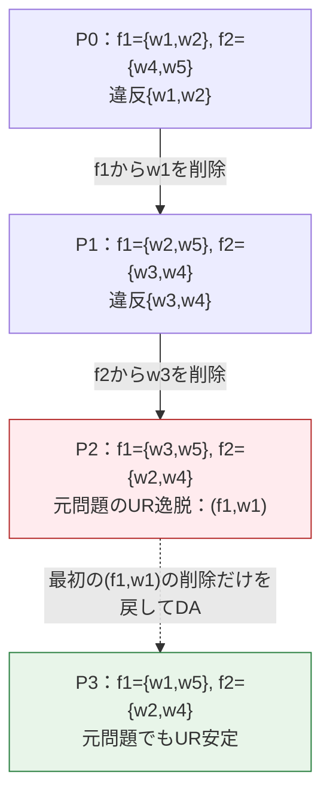

# 子問題の削除が祖先の削除を不要にする例：企業2・個人5・削除2段階

2026-11-04。個人告白型Recursive DA。定員は両企業とも2、選好は厳密、全員相互に受入可能。同僚の禁止関係は企業によらない。

**追記：「全分岐で元問題のUR安定を導出しない」を追加した再検査。** 代表の禁止集合に限定する処理を外し、さらに全37万5千選好×全1,024禁止集合、計3億8,400万入力を経路証明付きで検査した。この範囲ではすべての入力に少なくとも1本のUR安定な終点への経路があり、全分岐失敗の入力は0件だった。[再検査の結果・範囲・独立検算](all_graphs_recheck/README.md)

**求める干渉を削除2段階で再現できる。** 最初の削除は `(f1,w1)`、子問題での削除は `(f2,w3)`。終点では後者ではなく、祖先の削除組 `(f1,w1)` だけが元問題のUR逸脱になる。子問題の削除だけを残して最初の削除を戻すと、元問題でもUR安定になる。

「2段階」は、元問題のDAと2回の削除後のDA、計3回のDAを指す。主例では探索木全体の最大削除深さも2である。

[図入りの3ページPDF](output/pdf/two_level_ancestor_interference.pdf) にも主例・機構・全分岐・検算範囲をまとめた。

## 主例の選好

| 企業 | 選好 | 定員 |
|---|---|---:|
| f1 | w4 ≻ w2 ≻ w1 ≻ w5 ≻ w3 | 2 |
| f2 | w4 ≻ w5 ≻ w3 ≻ w2 ≻ w1 | 2 |

| 個人 | 選好 |
|---|---|
| w1, w2, w3, w4 | f2 ≻ f1 ≻ 未マッチ |
| w5 | f1 ≻ f2 ≻ 未マッチ |

共通禁止ペアは **{w1,w2} と {w3,w4} の2組だけ**。

入力は [problem.json](results/main_two_forbidden_pairs/problem.json)。企業・個人の受入不可や、空席への追加逸脱は、この主例の失敗原因に必要ない。

## 対象経路と、最初の削除を戻した比較

以下のP番号は4通りの比較を区別する記号であり、全分岐図のN番号とは別である。

| 問題 | 累積削除 | f1 | f2 | 未マッチ | 状態 |
|---|---|---|---|---|---|
| P0：元問題 | なし | {w1,w2} | {w4,w5} | w3 | f1で{w1,w2}違反 |
| P1：親からの削除後 | (f1,w1) | {w2,w5} | {w3,w4} | w1 | f2で{w3,w4}違反 |
| P2：子でも削除した終点 | (f1,w1), (f2,w3) | {w3,w5} | {w2,w4} | w1 | 削除後ではUR安定、元問題では(f1,w1)がUR逸脱 |
| P3：子の削除だけ残す | (f2,w3) | {w1,w5} | {w2,w4} | w3 | **元問題でもUR安定** |



P3は比較用のDAであり、Recursive DAの削除だけでたどる対象経路のノードではない。P0でまだ同居していない{w3,w4}を先に処理した、という主張もしない。

## 子の削除が、親の削除理由にどう干渉するか

元問題P0では、w3がf2に提案して仮受諾される。その後w4もf2へ来るので、w2がf2から拒否され、f1に提案する。f1はw1とw2を採用し、禁止ペア{w1,w2}が成立する。その過程でf1から押し出されたw5がf2へ移り、w3は最後にはf2から拒否される。

ところが子問題の削除 `(f2,w3)` が存在すると、**この最初のw3の仮受諾が起こらない**。f2はw2とw4をそのまま保持し、w2はf1へ提案しない。したがってw1をf1へ戻しても、{w1,w2}は再発しない。

削除の依存関係は次のとおり。

> 子でw3をf2から削除 → w2がf2から押し出されなくなる → w2がf1に来なくなる → 親が避けたかった{w1,w2}の成立経路が消える → (f1,w1)の削除を累積しておくことが、元問題でのUR逸脱を生む。

通常DAでは、最終的に不採用になる個人の途中の仮受諾も玉突きを起こす。この主例では、P0のw3は最終的には未マッチだが、そのf2への提案をあらかじめ拒否すると、ほかの個人の最終所属が変わる。

全提案・拒否・所属の履歴は [比較と提案履歴](results/main_two_forbidden_pairs/counterfactual_traces.md) と [機械可読JSON](results/main_two_forbidden_pairs/counterfactual_traces.json) にある。

## P2のUR逸脱を、DAの再実行とは別に直接確認する

P2ではf1={w3,w5}、w1は未マッチ。

1. w1は未マッチよりf1を好む。
2. 元の企業選好ではf1はw1をw3・w5の両方より好む。
3. w3を置き換えると{w1,w5}、w5を置き換えると{w1,w3}となり、どちらも禁止ペアではない。

よって `(f1,w1)` はuniversal replacementの逸脱である。空席への追加逸脱ではない。

最後に削除した `(f2,w3)` については、f2={w2,w4}のうちw2を置き換えると禁止ペア{w3,w4}が生じる。すべての置換が実行可能という条件を満たさず、この組はUR逸脱ではない。ほかの組も含めて全候補を検査しており、P2の元問題でのUR逸脱は `(f1,w1)` の1組だけである。

P3はP2のf1のw3をw1に置き換えた割当と一致する。ただしP3のUR安定性は、この置換の実行可能性だけから推論せず、全組を検査して確認した。

## 元のN6との一致点と相違点

一致するのは「後の削除が玉突きの経路を遮断し、祖先で残した相方がその企業に来なくなり、祖先の削除組が元問題のUR逸脱になる」という仕組みである。

相違するのは、**この主例では2回の削除対象が異なる個人である**こと。元のN6の `(f1,w6) → … → (f2,w6)` と同じ個人の二重削除まで要求すると、この企業2・個人5・定員各2の厳密選好の範囲では該当例は0だった。同じ禁止ペアを別企業で再び処理する形も0だった。

したがって、この例は一般的な「子の削除による祖先の削除理由の消滅」を2段階で実現する。元のN6の同一個人・同一禁止ペアという構造を、そのまま2段階へ縮めたものではない。

## 全分岐と、さらに枠数を減らした別例

主例は [全分岐図](results/main_two_forbidden_pairs/recursive_doctor.md) のとおり7ノード・4終点、最大削除深さ2。元問題でUR安定な終点は2つ、不安定な終点は2つある。この市場自体のUR安定解の不存在や、全分岐の失敗を示す例ではない。

禁止ペアを3組にすると、[5ノード・3終点の別例](results/compact_three_leaves/recursive_doctor.md) も得られる。[入力](results/compact_three_leaves/problem.json) と [比較履歴](results/compact_three_leaves/counterfactual_traces.md) を保存した。主例は、禁止関係を2組に抑える点を優先して選んだ。

## 数値に依存しない20通りの選好の族

個人選好と禁止ペアを主例のまま固定すると、上の4つのDA結果をすべて維持する企業選好は、次の部分順序でちょうど記述できる。

- f1：w1,w2はいずれもw5より上、w5はw3より上。w4の位置は任意。
- f2：w4,w5はいずれもw3より上、w3 ≻ w2 ≻ w1。

w1とw2の相互順位、w4とw5の相互順位も、それぞれ上記条件の範囲で任意。f1は10通り、f2は2通りで、計20通りになる。企業選好120²=14,400通りを実際に検査し、この条件が上の4割当を生むために必要十分であることを確認した。20通りすべてで探索木の最大深さは2だった。[検算](family_verification.json)

## 全探索の範囲と検算

各企業の定員は2に固定。受入可能な企業間および未マッチとの間に無差別はない。企業によらないbinary同僚拒否を共通禁止グラフとして扱う。初期の企業側受入不可も含めた、これらの仮定の範囲を列挙した。

| 入力範囲 | 個人名を正規化した選好数 | 削除2段階の経路数 | 祖先の削除を戻す比較まで満たす経路数 | そのうち満員終点 |
|---|---:|---:|---:|---:|
| 2企業・5人、全員受入可能 | 3,840 | 61,440 | 15,104 | 10,304 |
| 2企業・5人、受入不可も許す | 375,000 | 3,054,720 | 684,344 | 124,144 |
| 2企業・4人、受入不可も許す | 15,000 | 66,432 | 12,928 | 0 |

経路数は、同一の選好・同一の削除に至っても、選んだ禁止ペアが異なれば別に数える。各経路について条件を満たす禁止グラフが少なくとも1つあるかを調べた数であり、市場の同型類数ではない。5人の全員受入可能の範囲は、受入不可を許す範囲に含まれる。

正規化の根拠：

1. 片側だけが拒否する組は相互の受入不可にしてよい。通常DAでの最終割当、個人合理的な割当、UR逸脱の可否を変えない。
2. 受入不可を個人側のリストにまとめ、企業の受入可能な個人の順位を完全な厳密順序へ拡張できる。
3. 個人名をf1の順位に沿って付け替えると、f1の順序を固定できる。f2の順序は5!=120通り、各個人のリストは「f1>f2、f2>f1、f1のみ、f2のみ、両方不可」の5通り。計120×5⁵=375,000通り。
4. 禁止グラフは5人の10組の各辺の有無で表す。選択した2つの禁止ペアを必須とし、終点の同居・UR逸脱候補との両立条件を満たすグラフを調べる。不要な枝刈りはせず、これらの必要条件でのみ除外する。

同じ個人を2回削除する厳しい形が0という結論も、この有限範囲の結論である。企業数、定員、個人数、無差別を含む選好へ拡張した一般的な不可能性定理ではない。

補助探索として、個人5人のまま定員を各1〜5の25組に変え、同じ個人を2回削除する経路に絞ったC++探索も行った。計9,375,000個の正規化選好で、祖先の削除を戻す比較まで満たす形は0だった。[生データ](repeated_worker_capacity_sweep.json)。この補助探索の定員2以外の集計は、上の独立Pythonによる全列挙照合の対象には含めていない。

個人4人以下では両企業を満員にする本条件の例がなく、5人で構成できた。したがって**企業2・定員各2・厳密選好・終点が両企業満員という条件では、5人が最小**である。満員条件を外すと4人でも干渉の例があり、この最小性は主張しない。

検算は3系統で行った。

- 探索専用C++：FIFOに逐次提案し、禁止グラフを直接列挙。
- 独立Python：同時提案を各ラウンドで処理するDAと、禁止グラフの単調性を使う別の存在判定。全列挙の集計値が一致。
- 既存リポジトリのC++本体と、既存の独立Python検算器：主例・別例の全ノード、全分岐、全終点、元問題/削除後のUR判定が一致。

主例・別例については、未マッチを含む全3⁵=243割当も列挙し、元問題の全UR安定割当を [verification.json](results/main_two_forbidden_pairs/verification.json) に保存した。

## 再現方法

以下はこのREADMEのあるディレクトリで実行する。既存の実験・入力ファイルは変更しない。生成先は本ディレクトリ配下。

```sh
c++ -std=c++17 -O3 search.cpp -o /tmp/ancestor_search
/tmp/ancestor_search complete complete
/tmp/ancestor_search incomplete incomplete
python3 verify_exhaustive.py --workers 5 --complete --compare complete_summary.json --output independent_2x5_complete.json
python3 verify_exhaustive.py --workers 5 --compare incomplete_summary.json --output independent_2x5_incomplete.json
python3 verify_exhaustive.py --workers 4 --output independent_2x4.json
python3 analyze_candidates.py
python3 verify_family.py
c++ -std=c++17 -O2 -I ../../../include repository_bridge.cpp ../../../src/Matching.cpp ../../../src/Utils.cpp ../../../src/MatchingUtils.cpp ../../../src/algorithms.cpp ../../../src/algorithmsUtils.cpp -o /tmp/ancestor_repository_bridge
python3 build_evidence.py /tmp/ancestor_repository_bridge
sh build_pdf.sh
```

主な生データは `complete_summary.json`、`incomplete_summary.json`、`independent_2x5_incomplete.json`、`candidate_analysis.json`。`*_witnesses.jsonl` のうち一般の証拠例は先頭分に制限して保存し、`*_focused_witnesses.jsonl` は満員終点・異なる企業・子で新しく生じた禁止ペア・祖先削除を戻す比較の条件を満たす全経路を保存している。これらの候補は既存のPythonモデルでもすべて検算した。
