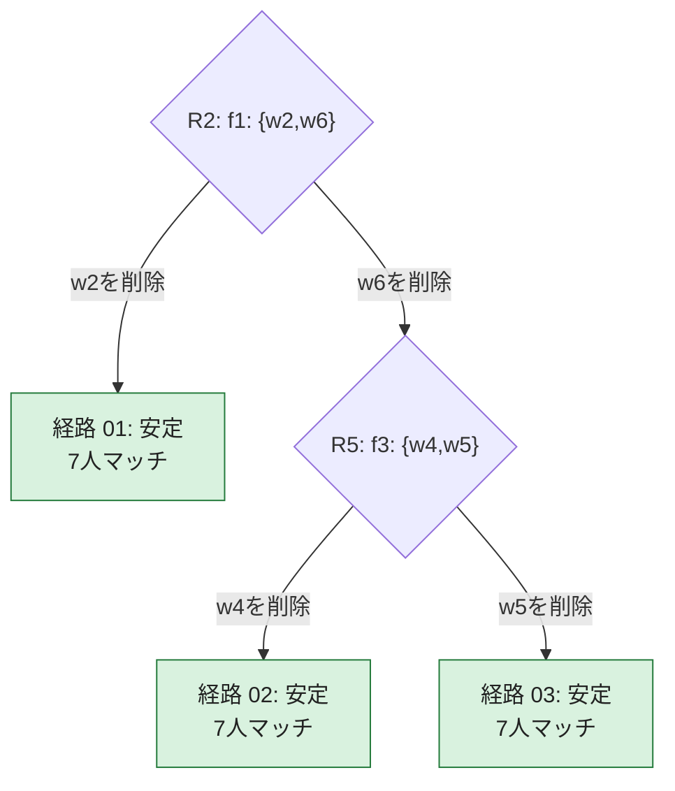
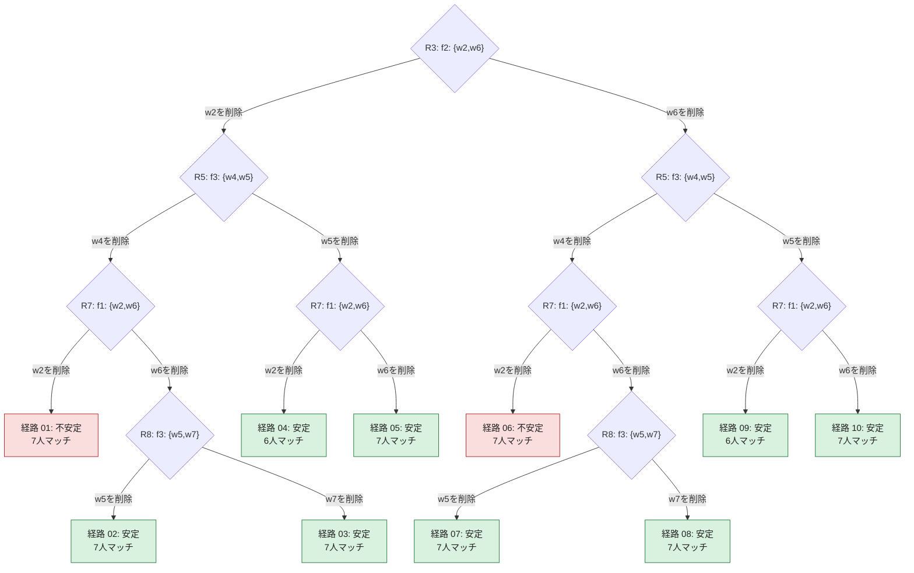

# 全13経路の詳細と削除の分岐図

現在の実装を独立したPythonモデルで全ラウンド再計算した結果、**firmは3経路、doctorは10経路で一致した**。

C++の保存結果と、全経路の各選択・選択時点のマッチング・最終結果を照合した。同じ最終結果になる経路も合流させず数えている。

## 経路数が小さい理由

2択の削除が毎回k回起こる完全な二分木なら2^k経路になる。しかし今回、禁止ペアのないラウンドでは選択が発生せず、枝によって次の禁止ペアの有無が変わる。

- firm：R2の削除でw2を選ぶ枝は以後分岐せず1経路。w6を選ぶ枝はR5で2択に分かれるので2経路。合計 **1+2=3**。
- doctor：R3に2択。どちらの枝でもR5でw4を削除する側は3経路、w5を削除する側は2経路に分かれる。合計 **2×(3+2)=10**。
- 全ラウンドの同時禁止ペアは最大1組。ペア処理順で増える経路はない。
- firmの削除回数は経路により1〜2回、doctorは3〜4回。全枝が同じ深さまで分岐するわけではない。

指数的に増える可能性は一般にはあるが、この固定問題の実際の分岐は以下の木となる。

## 今回確認した実装の仕様

Aは全企業／全未マッチ労働者の1ラウンド。各提案者は1人／1企業に提案する。全提案の受諾後にBを行う。
Bでの削除はその企業について永久。**提案履歴と他の暫定マッチングを保持し、削除後も最初からDAをやり直さない。**
企業は満員なら提案せず、労働者は所属先があれば提案しない。提案できる相手がなくなれば停止する。
この提案履歴保持は経路数にも影響する。削除後にDAを初期状態から再実行する別の仕様の経路数は、この調査には含まない。

## 元の問題

定員：f1=2, f2=2, f3=2, f4=2, f5=1。

| 企業 | 選好（左ほど好む） |
|---|---|
| f1 | w2 > w6 > w7 > w1 > w5 > w8 > w3 |
| f2 | w3 > w1 > w6 > w2 > w7 > w4 |
| f3 | w7 > w4 > w2 > w5 > w1 > w3 > w6 |
| f4 | w6 > w7 > w4 |
| f5 | w8 > w1 > w4 > w3 |

| 労働者 | 選好（左ほど好む） |
|---|---|
| w1 | f1 > f3 > f2 > f5 |
| w2 | f2 > f1 > f3 |
| w3 | f3 > f2 > f5 > f1 |
| w4 | f2 > f3 > f4 > f5 |
| w5 | f1 > f3 |
| w6 | f3 > f2 > f1 > f4 |
| w7 | f2 > f1 > f3 > f4 |
| w8 | f1 > f5 |

禁止同僚ペア：{w2,w3}、{w2,w6}、{w2,w8}、{w3,w5}、{w4,w5}、{w5,w7}、{w5,w8}、{w6,w8}、{w7,w8}。

## firm proposingの全分岐

禁止ペアが生じた時点の削除選択だけを示す。分岐のないラウンドは個別ファイルに全て載せている。

| 経路 | 安定性 | マッチ人数 | 全ラウンドの詳細 |
|---|---|---:|---|
| 01 | 安定 | 7 | [経路01](firm_path_01.md) |
| 02 | 安定 | 7 | [経路02](firm_path_02.md) |
| 03 | 安定 | 7 | [経路03](firm_path_03.md) |

## doctor / worker proposingの全分岐

禁止ペアが生じた時点の削除選択だけを示す。分岐のないラウンドは個別ファイルに全て載せている。

| 経路 | 安定性 | マッチ人数 | 全ラウンドの詳細 |
|---|---|---:|---|
| 01 | 不安定 (f3,w4) | 7 | [経路01](worker_path_01.md) |
| 02 | 安定 | 7 | [経路02](worker_path_02.md) |
| 03 | 安定 | 7 | [経路03](worker_path_03.md) |
| 04 | 安定 | 6 | [経路04](worker_path_04.md) |
| 05 | 安定 | 7 | [経路05](worker_path_05.md) |
| 06 | 不安定 (f3,w4) | 7 | [経路06](worker_path_06.md) |
| 07 | 安定 | 7 | [経路07](worker_path_07.md) |
| 08 | 安定 | 7 | [経路08](worker_path_08.md) |
| 09 | 安定 | 6 | [経路09](worker_path_09.md) |
| 10 | 安定 | 7 | [経路10](worker_path_10.md) |

## 検算の記録

[独立再計算の集計](recorded_results/da_paths_1791356176635/path_details/verification.json)、[firm全ラウンドJSON](recorded_results/da_paths_1791356176635/path_details/firm_round_traces.json)、[doctor全ラウンドJSON](recorded_results/da_paths_1791356176635/path_details/worker_round_traces.json)。

Pythonで別実装したラウンド遷移から全分岐を生成し、全13経路がC++出力と完全一致することを確認した。保存された経路を読むだけの可視化ではない。

安定性は削除前の元の選好で検算。空席への追加blockingは含まない。経路数の比を成功確率とは解釈しない。
