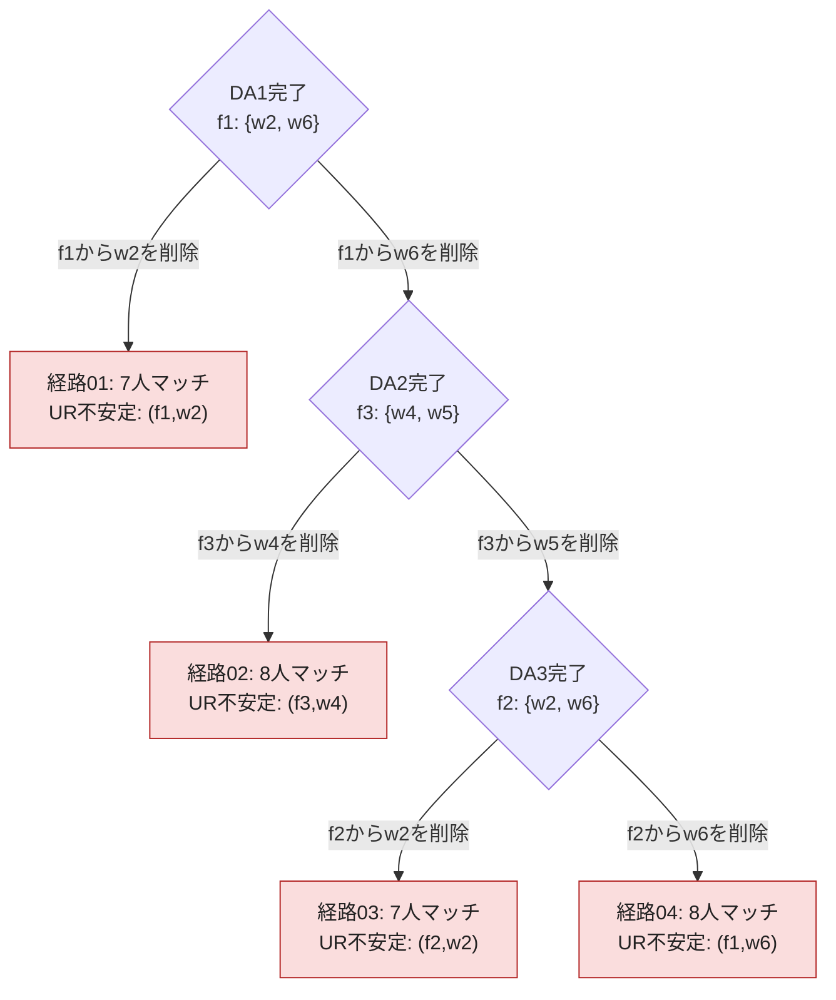

# 再実行型doctor proposing DA：全経路探索と仮説の検証

**この固定問題では仮説が成立する。全4経路を探索した結果、UR安定な終点は0件だった。**

対象は `iterated_doctor_proposing_DA_algorithm`。DAを終了まで実行し、拒否ペアを1組選んで片方を削除し、更新した選好でDAを最初から再実行する方式を検証した。

## 集計

| 項目 | 結果 |
|---|---:|
| 全選択経路 | 4 |
| UR安定な経路 | 0 |
| UR不安定な経路 | 4 |
| 異なる最終マッチング | 4 |
| 最大同時禁止ペア | 1 |
| 経路ごとの削除回数 | 1〜3 |
| 経路ごとの完全DA実行回数 | 2〜4 |

本資料でのUR安定は、定員・個人合理性・同僚制約を満たし、元の選好に対するuniversal-replacement blocking pairがないこと。空席への追加blockingは含めない。

## 全経路の分岐図

各分岐の前には、同僚選好を無視したDAを**最後まで**実行する。各矢印の後に削除を累積し、全員未マッチ・提案履歴なしから再実行する。

経路数は **1 + 1 + 2 = 4**。最初にw2を削除した枝は直ちに終点へ進む。w6を削除した枝は次の禁止ペアで2分岐し、その片方だけがさらに2分岐する。

## 全経路の終点

| 経路 | 累積削除の順序 | f1 | f2 | f3 | f4 | f5 | 未マッチ | UR blocking pair | 詳細 |
|---|---|---|---|---|---|---|---|---|---|
| 01 | (f1,w2) | {w1, w7} | {w3, w6} | {w2, w4} | ∅ | {w8} | {w5} | (f1,w2) | [経路01](doctor_path_01.md) |
| 02 | (f1,w6) → (f3,w4) | {w1, w5} | {w2, w7} | {w3, w6} | {w4} | {w8} | ∅ | (f3,w4) | [経路02](doctor_path_02.md) |
| 03 | (f1,w6) → (f3,w5) → (f2,w2) | {w1, w2} | {w4, w7} | {w3, w6} | ∅ | {w8} | {w5} | (f2,w2) | [経路03](doctor_path_03.md) |
| 04 | (f1,w6) → (f3,w5) → (f2,w6) | {w1, w5} | {w2, w7} | {w3, w4} | {w6} | {w8} | ∅ | (f1,w6) | [経路04](doctor_path_04.md) |

8人全員がマッチする経路02・04でもblocking pairがある。各経路の詳細に、候補の企業選好、企業側の比較、全在籍者についての置換後集合を載せた。

## なぜ禁止ペアがなくても不安定なのか

終了条件は同じ企業に禁止同僚ペアがないこと。これは、元の市場でのUR安定性を保証しない。4経路すべてで、残ったblocking pairは過去に削除した企業・個人の組そのものだった。削除によってDAの候補から外されても、元の企業選好では依然として好まれており、終了時の在籍者となら禁止同僚ペアを作らずに置換できる。

## 元の問題

定員は `(2,2,2,2,1)`。順位表にない相手は受け入れ不可。

| 企業 | 元の受け入れ可能な順位 |
|---|---|
| f1 | w2 > w6 > w7 > w1 > w5 > w8 > w3 |
| f2 | w3 > w1 > w6 > w2 > w7 > w4 |
| f3 | w7 > w4 > w2 > w5 > w1 > w3 > w6 |
| f4 | w6 > w7 > w4 |
| f5 | w8 > w1 > w4 > w3 |

| 個人 | 企業への順位 |
|---|---|
| w1 | f1 > f3 > f2 > f5 |
| w2 | f2 > f1 > f3 |
| w3 | f3 > f2 > f5 > f1 |
| w4 | f2 > f3 > f4 > f5 |
| w5 | f1 > f3 |
| w6 | f3 > f2 > f1 > f4 |
| w7 | f2 > f1 > f3 > f4 |
| w8 | f1 > f5 |

禁止同僚ペア（対称）：{w2, w3}、{w2, w6}、{w2, w8}、{w3, w5}、{w4, w5}、{w5, w7}、{w5, w8}、{w6, w8}、{w7, w8}。

## 安定性の定義

企業fと現在そこにいない個人wが、以下をすべて満たす場合にUR blocking pairとする。

1. 企業fが満員である。
2. 個人wが現在の企業よりfを厳密に好む（未マッチの評価は0）。
3. 企業fが少なくとも1人の在籍者よりwを厳密に好む。
4. どの在籍者1人をwに置き換えても、置換後に禁止同僚ペアがない。

判定には、削除を反映した一時的な企業選好ではなく、**削除前の元の企業選好**を用いた。

## 全探索と独立検算

C++の `enumerate_choice_paths` が実際のアルゴリズムを再生し、未指定の意思決定に達するたびに全選択肢へ分岐する。ペアが複数なら全ペア、削除対象は両端点を列挙する。seedのサンプリングや、安定解が見つかった時点での打ち切りは行わない。

本問題では各DA完了時の禁止ペアは高々1組なので、全分岐は削除対象の2択。DA内の受け入れ可能な順位は厳密であり、提案順の追加の乱択はない。

Pythonは元の問題から標準DAと削除の分岐を別実装し、C++を呼ばずに全4経路を生成した。各選択のDA番号・選択肢・削除前の割当・削除対象・終点をC++ JSONLと完全照合し、元の選好からblocking pairも再計算した。CSVとの一致も確認した。

## 仮説が成立する範囲

確認したのは、添付画像の固定された5企業・8個人問題と、今回の再実行型doctor提案DA。このアルゴリズムのあらゆる削除選択経路でUR安定な結果に到達できない。

これは全市場に対する一般定理や、この市場に安定マッチングが存在しないという主張ではない。また、各提案ラウンド後に削除し提案履歴を保持する既存の `modified_worker_proposing_DA_algorithm` は別の方式であり、[既存の調査](../modified_docs/da_paths_index.md)では10経路中8経路がUR安定だった。

## 保存した検証データ

- [C++集計](recorded_results/iterated_doctor_paths_1791367650792/summary.txt)
- [元の全選好](recorded_results/iterated_doctor_paths_1791367650792/problem.json)
- [C++全経路JSONL](recorded_results/iterated_doctor_paths_1791367650792/iterated_doctor_paths.jsonl)
- [全経路CSV](recorded_results/iterated_doctor_paths_1791367650792/iterated_doctor_paths.csv)
- [独立検算の集計](recorded_results/iterated_doctor_paths_1791367650792/verification.json)
- [全DA・全提案の独立計算ログ](recorded_results/iterated_doctor_paths_1791367650792/doctor_da_traces.json)

再実行方法は [README](README.md) を参照。
