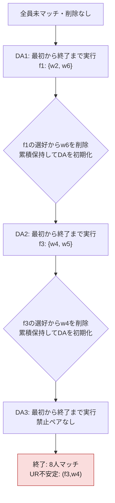

# 再実行型doctor proposing DA — 経路 02

[全経路の結論・分岐図](da_paths_index.md)

最終結果は **UR不安定**。8人がマッチし、blocking pairは **(f3,w4)**。

削除履歴：DA1: (f1,w6) → DA2: (f3,w4)。DA実行回数は3回。

以下の全DA・全削除・最終割当は、独立Pythonモデルと実際のC++アルゴリズムで一致した。

## この経路の流れ

## 最終マッチング

| 企業 | 所属労働者 |
|---|---|
| f1 | {w1, w5} |
| f2 | {w2, w7} |
| f3 | {w3, w6} |
| f4 | {w4} |
| f5 | {w8} |
| 未マッチ | ∅ |

## DA実行ごとの詳細

DA番号は完全なDAの実行回数。内部の提案ラウンド番号ではない。毎回、全員未マッチから開始する。

### DA1

開始時の累積削除：なし。

**A：同僚選好を無視してDAを完了**

| 企業 | 所属労働者 |
|---|---|
| f1 | {w2, w6} |
| f2 | {w1, w3} |
| f3 | {w4, w7} |
| f4 | ∅ |
| f5 | {w8} |
| 未マッチ | {w5} |

**DA内部の全提案**

仮受諾後に別の提案で拒否される場合がある。企業からの拒否・削除済み企業への提案も記録する。

| 順番 | 提案 | その時点での処理 |
|---|---|---|
| 1 | w1 → f1 | 仮受諾：空席あり |
| 2 | w2 → f2 | 仮受諾：空席あり |
| 3 | w3 → f3 | 仮受諾：空席あり |
| 4 | w4 → f2 | 仮受諾：空席あり |
| 5 | w5 → f1 | 仮受諾：空席あり |
| 6 | w6 → f3 | 仮受諾：空席あり |
| 7 | w7 → f2 | 仮受諾：w4を拒否し直す |
| 8 | w8 → f1 | 拒否：満員で、最下位の在籍者より好まれない |
| 9 | w4 → f3 | 仮受諾：w6を拒否し直す |
| 10 | w8 → f5 | 仮受諾：空席あり |
| 11 | w6 → f2 | 仮受諾：w7を拒否し直す |
| 12 | w7 → f1 | 仮受諾：w5を拒否し直す |
| 13 | w5 → f3 | 仮受諾：w3を拒否し直す |
| 14 | w3 → f2 | 仮受諾：w2を拒否し直す |
| 15 | w2 → f1 | 仮受諾：w1を拒否し直す |
| 16 | w1 → f3 | 拒否：満員で、最下位の在籍者より好まれない |
| 17 | w1 → f2 | 仮受諾：w6を拒否し直す |
| 18 | w6 → f1 | 仮受諾：w7を拒否し直す |
| 19 | w7 → f3 | 仮受諾：w5を拒否し直す |

受け入れ可能な企業への提案が尽きるか、全員が仮受諾を得ると、このDAは終了する。

**B：完了したDAの禁止ペアを確認**

- f1: {w2, w6}

選択した組はf1: {w2, w6}。削除の2択はw2／w6。

この経路では **f1からw6を削除**。

**C：更新した企業選好を累積保持**

累積削除：(f1,w6)。

| 企業 | 更新後の受け入れ可能な順位 |
|---|---|
| f1 | w2 > w7 > w1 > w5 > w8 > w3 |
| f2 | w3 > w1 > w6 > w2 > w7 > w4 |
| f3 | w7 > w4 > w2 > w5 > w1 > w3 > w6 |
| f4 | w6 > w7 > w4 |
| f5 | w8 > w1 > w4 > w3 |

個人の企業選好・同僚選好は元のまま。全マッチと全提案履歴を初期化して次のDAへ進む。

### DA2

開始時の累積削除：(f1,w6)。

**A：同僚選好を無視してDAを完了**

| 企業 | 所属労働者 |
|---|---|
| f1 | {w2, w7} |
| f2 | {w1, w3} |
| f3 | {w4, w5} |
| f4 | {w6} |
| f5 | {w8} |
| 未マッチ | ∅ |

**DA内部の全提案**

仮受諾後に別の提案で拒否される場合がある。企業からの拒否・削除済み企業への提案も記録する。

| 順番 | 提案 | その時点での処理 |
|---|---|---|
| 1 | w1 → f1 | 仮受諾：空席あり |
| 2 | w2 → f2 | 仮受諾：空席あり |
| 3 | w3 → f3 | 仮受諾：空席あり |
| 4 | w4 → f2 | 仮受諾：空席あり |
| 5 | w5 → f1 | 仮受諾：空席あり |
| 6 | w6 → f3 | 仮受諾：空席あり |
| 7 | w7 → f2 | 仮受諾：w4を拒否し直す |
| 8 | w8 → f1 | 拒否：満員で、最下位の在籍者より好まれない |
| 9 | w4 → f3 | 仮受諾：w6を拒否し直す |
| 10 | w8 → f5 | 仮受諾：空席あり |
| 11 | w6 → f2 | 仮受諾：w7を拒否し直す |
| 12 | w7 → f1 | 仮受諾：w5を拒否し直す |
| 13 | w5 → f3 | 仮受諾：w3を拒否し直す |
| 14 | w3 → f2 | 仮受諾：w2を拒否し直す |
| 15 | w2 → f1 | 仮受諾：w1を拒否し直す |
| 16 | w1 → f3 | 拒否：満員で、最下位の在籍者より好まれない |
| 17 | w1 → f2 | 仮受諾：w6を拒否し直す |
| 18 | w6 → f1 | 拒否：この企業の選好から削除済み |
| 19 | w6 → f4 | 仮受諾：空席あり |

受け入れ可能な企業への提案が尽きるか、全員が仮受諾を得ると、このDAは終了する。

**B：完了したDAの禁止ペアを確認**

- f3: {w4, w5}

選択した組はf3: {w4, w5}。削除の2択はw4／w5。

この経路では **f3からw4を削除**。

**C：更新した企業選好を累積保持**

累積削除：(f1,w6)、(f3,w4)。

| 企業 | 更新後の受け入れ可能な順位 |
|---|---|
| f1 | w2 > w7 > w1 > w5 > w8 > w3 |
| f2 | w3 > w1 > w6 > w2 > w7 > w4 |
| f3 | w7 > w2 > w5 > w1 > w3 > w6 |
| f4 | w6 > w7 > w4 |
| f5 | w8 > w1 > w4 > w3 |

個人の企業選好・同僚選好は元のまま。全マッチと全提案履歴を初期化して次のDAへ進む。

### DA3

開始時の累積削除：(f1,w6)、(f3,w4)。

**A：同僚選好を無視してDAを完了**

| 企業 | 所属労働者 |
|---|---|
| f1 | {w1, w5} |
| f2 | {w2, w7} |
| f3 | {w3, w6} |
| f4 | {w4} |
| f5 | {w8} |
| 未マッチ | ∅ |

**DA内部の全提案**

仮受諾後に別の提案で拒否される場合がある。企業からの拒否・削除済み企業への提案も記録する。

| 順番 | 提案 | その時点での処理 |
|---|---|---|
| 1 | w1 → f1 | 仮受諾：空席あり |
| 2 | w2 → f2 | 仮受諾：空席あり |
| 3 | w3 → f3 | 仮受諾：空席あり |
| 4 | w4 → f2 | 仮受諾：空席あり |
| 5 | w5 → f1 | 仮受諾：空席あり |
| 6 | w6 → f3 | 仮受諾：空席あり |
| 7 | w7 → f2 | 仮受諾：w4を拒否し直す |
| 8 | w8 → f1 | 拒否：満員で、最下位の在籍者より好まれない |
| 9 | w4 → f3 | 拒否：この企業の選好から削除済み |
| 10 | w8 → f5 | 仮受諾：空席あり |
| 11 | w4 → f4 | 仮受諾：空席あり |

受け入れ可能な企業への提案が尽きるか、全員が仮受諾を得ると、このDAは終了する。

**B：完了したDAの禁止ペアを確認**

禁止ペアはない。このマッチングを返してアルゴリズムを終了する。

## 元の選好による安定性判定

最終マッチングは定員を守り、個人合理的で、禁止同僚ペアもない。

ただし、削除前の元の選好で評価すると以下のblocking pairがある。

### (f3, w4) がblocking pairであること

1. f3の在籍者は{w3, w6}。人数2は定員2と等しい。
2. w4は現在のf4よりf3を厳密に好む（元のスコア：3 > 2）。
3. f3はw4を、少なくとも在籍者{w3, w6}より厳密に好む。
4. **どの在籍者1人を置き換えても**、置換後の所属集合に禁止同僚ペアはない。

| 置き換える在籍者 | 置換後の所属集合 | 同僚制約 |
|---|---|---|
| w3 | {w4, w6} | 禁止ペアなし |
| w6 | {w3, w4} | 禁止ペアなし |

したがって、元の市場では **(f3, w4)** がuniversal-replacement blocking pairとなる。

削除によって企業の候補から除外された個人との関係も、元の市場に戻して判定する。
