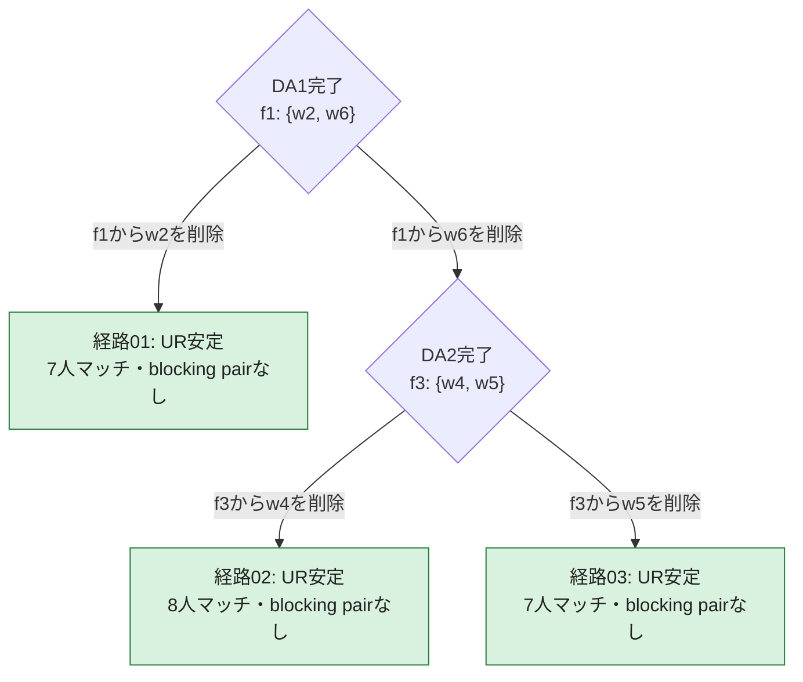

# 再実行型firm proposing DA：全経路探索

**この固定問題では全3経路がUR安定だった。うち経路02は8人全員がマッチする。**

対象は `iterated_firm_proposing_DA_algorithm`。同僚選好を無視してfirm proposing DAを終了まで実行し、禁止ペアを1組選び、その片方を該当企業の選好から削除する。削除を累積保持してDAを最初から再実行する。

判定は削除前の元の選好に対するuniversal-replacement安定性。空席への追加blockingは含めない。

## 集計とdoctor版との比較

| 項目 | firm proposing | doctor proposing |
|---|---:|---:|
| 全経路 | 3 | 4 |
| UR安定な経路 | 3 | 0 |
| UR不安定な経路 | 0 | 4 |
| 異なる最終マッチング | 3 | 4 |
| 全員マッチかつUR安定な経路 | 1 | 0 |
| 最大同時禁止ペア | 1 | 1 |
| 削除回数 | 1〜2 | 1〜3 |
| 完全なDAの実行回数 | 2〜3 | 2〜4 |

doctor版の結果は [全4経路の調査](da_paths_index.md) を参照。今回の固定問題では「doctor版は全経路でUR不安定、firm版は全経路でUR安定」が確認できた。

## 全経路のMermaid分岐図

DA番号は完全なDAの実行回数。各削除後に全員未マッチ・提案履歴なしから再実行する。

最初の禁止ペアはf1の{w2,w6}。w2を削除した枝は次のDAで停止する。w6を削除した枝だけがf3の{w4,w5}でさらに2分岐するため、経路数は **1 + 2 = 3**。

## 全経路の終点

| 経路 | 削除の順序 | f1 | f2 | f3 | f4 | f5 | 未マッチ | マッチ人数 | UR blocking pair | 詳細 |
|---|---|---|---|---|---|---|---|---:|---|---|
| 01 | (f1,w2) | {w6, w7} | {w1, w3} | {w2, w4} | ∅ | {w8} | {w5} | 7 | なし | [経路01](firm_path_01.md) |
| 02 | (f1,w6) → (f3,w4) | {w2, w7} | {w3, w6} | {w1, w5} | {w4} | {w8} | ∅ | 8 | なし | [経路02](firm_path_02.md) |
| 03 | (f1,w6) → (f3,w5) | {w2, w7} | {w3, w6} | {w1, w4} | ∅ | {w8} | {w5} | 7 | なし | [経路03](firm_path_03.md) |

## 元の問題

定員は `(2,2,2,2,1)`。順位表にない相手は受け入れ不可。

| 企業 | 元の受け入れ可能な順位 |
|---|---|
| f1 | w2 > w6 > w7 > w1 > w5 > w8 > w3 |
| f2 | w3 > w1 > w6 > w2 > w7 > w4 |
| f3 | w7 > w4 > w2 > w5 > w1 > w3 > w6 |
| f4 | w6 > w7 > w4 |
| f5 | w8 > w1 > w4 > w3 |

| 個人 | 企業への順位 |
|---|---|
| w1 | f1 > f3 > f2 > f5 |
| w2 | f2 > f1 > f3 |
| w3 | f3 > f2 > f5 > f1 |
| w4 | f2 > f3 > f4 > f5 |
| w5 | f1 > f3 |
| w6 | f3 > f2 > f1 > f4 |
| w7 | f2 > f1 > f3 > f4 |
| w8 | f1 > f5 |

禁止同僚ペア（対称）：{w2, w3}、{w2, w6}、{w2, w8}、{w3, w5}、{w4, w5}、{w5, w7}、{w5, w8}、{w6, w8}、{w7, w8}。

## 安定性の確認方法

各終点が定員・個人合理性・禁止同僚ペアの制約を満たすことを確認し、全企業について、現在そこにいない全個人を元の選好で検査した。次の4条件を同時に満たす候補は、3経路とも存在しなかった。

1. 企業が満員である。
2. 個人が現在の企業よりその企業を厳密に好む（未マッチの評価は0）。
3. 企業が少なくとも1人の在籍者よりその個人を厳密に好む。
4. どの在籍者1人をその個人に置き換えても禁止同僚ペアがない。

各経路の資料に全候補の検査表を載せた。企業の選好から削除された個人も検査から除いていない。

## 全探索と独立検算

C++は実際のアルゴリズムに `DARandomChoiceSelector` を渡し、未指定の選択に達するたび全選択肢を分岐させる。複数の禁止ペアがあれば全ペアを、削除対象は両端点を探索する。seedのサンプリングや、安定解発見による早期終了は行わない。

独立Pythonモデルは、企業が順位の高い個人から空席が埋まるまで提案する通常DAを別実装した。個人がより好む企業に移ると旧企業の提案を再開し、各削除後に全状態を初期化する。そのモデルから削除の全分岐を生成し、C++の全選択履歴・削除前の割当・最終割当・blocking pair・CSVを照合した。3経路すべてで一致した。

## 結論が成立する範囲

対象は画像の固定された5企業・8個人問題と、今回の再実行型firm提案DA。この問題については、どの削除対象を選んでもUR安定な結果に到達する。全市場について同じ性質が成り立つという一般定理ではない。

各提案ラウンド後に削除して履歴を保持する方式は [従来の調査](../modified_docs/da_paths_index.md) を参照。従来のfirm版も3経路がUR安定だったが、今回の経路02は8人全員がマッチする点が異なる。

## 保存したデータ

- [C++集計](recorded_results/iterated_firm_paths_1791368334862/summary.txt)
- [元の全選好](recorded_results/iterated_firm_paths_1791368334862/problem.json)
- [C++全経路JSONL](recorded_results/iterated_firm_paths_1791368334862/iterated_firm_paths.jsonl)
- [全経路CSV](recorded_results/iterated_firm_paths_1791368334862/iterated_firm_paths.csv)
- [独立検算の集計](recorded_results/iterated_firm_paths_1791368334862/verification.json)
- [全DA・全提案の独立計算ログ](recorded_results/iterated_firm_paths_1791368334862/firm_da_traces.json)

再実行方法は [README](README.md) を参照。
