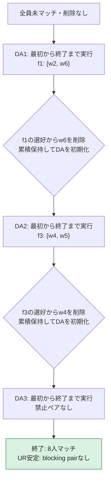

# 再実行型firm proposing DA — 経路 02

[全経路の結論・分岐図](firm_da_paths_index.md)

最終結果は **UR安定**。8人がマッチし、blocking pairは **なし**。

削除履歴：DA1: (f1,w6) → DA2: (f3,w4)。DA実行回数は3回。

以下の全DA・全削除・最終割当は、独立Pythonモデルと実際のC++アルゴリズムで一致した。

## この経路の流れ

## 最終マッチング

| 企業 | 所属労働者 |
|---|---|
| f1 | {w2, w7} |
| f2 | {w3, w6} |
| f3 | {w1, w5} |
| f4 | {w4} |
| f5 | {w8} |
| 未マッチ | ∅ |

## DA実行ごとの詳細

DA番号は完全なDAの実行回数。内部の提案ラウンド番号ではない。毎回、全員未マッチから開始する。

### DA1

開始時の累積削除：なし。

**A：同僚選好を無視してDAを完了**

| 企業 | 所属労働者 |
|---|---|
| f1 | {w2, w6} |
| f2 | {w1, w3} |
| f3 | {w4, w7} |
| f4 | ∅ |
| f5 | {w8} |
| 未マッチ | {w5} |

**DA内部の全提案**

個人はより好む企業の提案を受けると移る。削除済みの個人は企業の提案候補から除く。

| 順番 | 提案 | その時点での処理 |
|---|---|---|
| 1 | f1 → w2 | 仮受諾：未マッチから所属 |
| 2 | f1 → w6 | 仮受諾：未マッチから所属 |
| 3 | f2 → w3 | 仮受諾：未マッチから所属 |
| 4 | f2 → w1 | 仮受諾：未マッチから所属 |
| 5 | f3 → w7 | 仮受諾：未マッチから所属 |
| 6 | f3 → w4 | 仮受諾：未マッチから所属 |
| 7 | f4 → w6 | 拒否：現在のf1を維持 |
| 8 | f4 → w7 | 拒否：現在のf3を維持 |
| 9 | f4 → w4 | 拒否：現在のf3を維持 |
| 10 | f5 → w8 | 仮受諾：未マッチから所属 |

空席があって提案可能な個人が残る企業がなくなると、このDAは終了する。

**B：完了したDAの禁止ペアを確認**

- f1: {w2, w6}

選択した組はf1: {w2, w6}。削除の2択はw2／w6。

この経路では **f1からw6を削除**。

**C：更新した企業選好を累積保持**

累積削除：(f1,w6)。

| 企業 | 更新後の受け入れ可能な順位 |
|---|---|
| f1 | w2 > w7 > w1 > w5 > w8 > w3 |
| f2 | w3 > w1 > w6 > w2 > w7 > w4 |
| f3 | w7 > w4 > w2 > w5 > w1 > w3 > w6 |
| f4 | w6 > w7 > w4 |
| f5 | w8 > w1 > w4 > w3 |

個人の企業選好・同僚選好は元のまま。全マッチと全提案履歴を初期化して次のDAへ進む。

### DA2

開始時の累積削除：(f1,w6)。

**A：同僚選好を無視してDAを完了**

| 企業 | 所属労働者 |
|---|---|
| f1 | {w2, w7} |
| f2 | {w1, w3} |
| f3 | {w4, w5} |
| f4 | {w6} |
| f5 | {w8} |
| 未マッチ | ∅ |

**DA内部の全提案**

個人はより好む企業の提案を受けると移る。削除済みの個人は企業の提案候補から除く。

| 順番 | 提案 | その時点での処理 |
|---|---|---|
| 1 | f1 → w2 | 仮受諾：未マッチから所属 |
| 2 | f1 → w7 | 仮受諾：未マッチから所属 |
| 3 | f2 → w3 | 仮受諾：未マッチから所属 |
| 4 | f2 → w1 | 仮受諾：未マッチから所属 |
| 5 | f3 → w7 | 拒否：現在のf1を維持 |
| 6 | f3 → w4 | 仮受諾：未マッチから所属 |
| 7 | f3 → w2 | 拒否：現在のf1を維持 |
| 8 | f3 → w5 | 仮受諾：未マッチから所属 |
| 9 | f4 → w6 | 仮受諾：未マッチから所属 |
| 10 | f4 → w7 | 拒否：現在のf1を維持 |
| 11 | f4 → w4 | 拒否：現在のf3を維持 |
| 12 | f5 → w8 | 仮受諾：未マッチから所属 |

空席があって提案可能な個人が残る企業がなくなると、このDAは終了する。

**B：完了したDAの禁止ペアを確認**

- f3: {w4, w5}

選択した組はf3: {w4, w5}。削除の2択はw4／w5。

この経路では **f3からw4を削除**。

**C：更新した企業選好を累積保持**

累積削除：(f1,w6)、(f3,w4)。

| 企業 | 更新後の受け入れ可能な順位 |
|---|---|
| f1 | w2 > w7 > w1 > w5 > w8 > w3 |
| f2 | w3 > w1 > w6 > w2 > w7 > w4 |
| f3 | w7 > w2 > w5 > w1 > w3 > w6 |
| f4 | w6 > w7 > w4 |
| f5 | w8 > w1 > w4 > w3 |

個人の企業選好・同僚選好は元のまま。全マッチと全提案履歴を初期化して次のDAへ進む。

### DA3

開始時の累積削除：(f1,w6)、(f3,w4)。

**A：同僚選好を無視してDAを完了**

| 企業 | 所属労働者 |
|---|---|
| f1 | {w2, w7} |
| f2 | {w3, w6} |
| f3 | {w1, w5} |
| f4 | {w4} |
| f5 | {w8} |
| 未マッチ | ∅ |

**DA内部の全提案**

個人はより好む企業の提案を受けると移る。削除済みの個人は企業の提案候補から除く。

| 順番 | 提案 | その時点での処理 |
|---|---|---|
| 1 | f1 → w2 | 仮受諾：未マッチから所属 |
| 2 | f1 → w7 | 仮受諾：未マッチから所属 |
| 3 | f2 → w3 | 仮受諾：未マッチから所属 |
| 4 | f2 → w1 | 仮受諾：未マッチから所属 |
| 5 | f3 → w7 | 拒否：現在のf1を維持 |
| 6 | f3 → w2 | 拒否：現在のf1を維持 |
| 7 | f3 → w5 | 仮受諾：未マッチから所属 |
| 8 | f3 → w1 | 仮受諾：f2からf3へ移動 |
| 9 | f4 → w6 | 仮受諾：未マッチから所属 |
| 10 | f4 → w7 | 拒否：現在のf1を維持 |
| 11 | f4 → w4 | 仮受諾：未マッチから所属 |
| 12 | f5 → w8 | 仮受諾：未マッチから所属 |
| 13 | f2 → w6 | 仮受諾：f4からf2へ移動 |

空席があって提案可能な個人が残る企業がなくなると、このDAは終了する。

**B：完了したDAの禁止ペアを確認**

禁止ペアはない。このマッチングを返してアルゴリズムを終了する。

## 元の選好による安定性判定

最終マッチングは定員を守り、個人合理的で、禁止同僚ペアもない。

削除前の元の選好で全候補を調べても、universal-replacement blocking pairはない。

### 全企業・全個人の候補検査

各企業の在籍者を除く全候補を、削除前の元の選好で検査した。各行に、blocking pairの必要条件を満たさない理由を1つ示す。削除済みの企業・個人の組も除外せず検査する。

| 候補 | 現在の所属 | blocking pairにならない理由 |
|---|---|---|
| (f1,w1) | f3 | 企業が候補をどの在籍者よりも厳密に好まない |
| (f1,w3) | f2 | 個人がこの企業を現在の所属より厳密に好まない（受け入れ不可を含む） |
| (f1,w4) | f4 | 個人がこの企業を現在の所属より厳密に好まない（受け入れ不可を含む） |
| (f1,w5) | f3 | 企業が候補をどの在籍者よりも厳密に好まない |
| (f1,w6) | f2 | 個人がこの企業を現在の所属より厳密に好まない（受け入れ不可を含む） |
| (f1,w8) | f5 | 企業が候補をどの在籍者よりも厳密に好まない |
| (f2,w1) | f3 | 個人がこの企業を現在の所属より厳密に好まない（受け入れ不可を含む） |
| (f2,w2) | f1 | 企業が候補をどの在籍者よりも厳密に好まない |
| (f2,w4) | f4 | 企業が候補をどの在籍者よりも厳密に好まない |
| (f2,w5) | f3 | 個人がこの企業を現在の所属より厳密に好まない（受け入れ不可を含む） |
| (f2,w7) | f1 | 企業が候補をどの在籍者よりも厳密に好まない |
| (f2,w8) | f5 | 個人がこの企業を現在の所属より厳密に好まない（受け入れ不可を含む） |
| (f3,w2) | f1 | 個人がこの企業を現在の所属より厳密に好まない（受け入れ不可を含む） |
| (f3,w3) | f2 | 企業が候補をどの在籍者よりも厳密に好まない |
| (f3,w4) | f4 | w1の置換で禁止ペア{w4, w5}が生じる |
| (f3,w6) | f2 | 企業が候補をどの在籍者よりも厳密に好まない |
| (f3,w7) | f1 | 個人がこの企業を現在の所属より厳密に好まない（受け入れ不可を含む） |
| (f3,w8) | f5 | 個人がこの企業を現在の所属より厳密に好まない（受け入れ不可を含む） |
| (f4,w1) | f3 | 企業が満員ではない（1/2人） |
| (f4,w2) | f1 | 企業が満員ではない（1/2人） |
| (f4,w3) | f2 | 企業が満員ではない（1/2人） |
| (f4,w5) | f3 | 企業が満員ではない（1/2人） |
| (f4,w6) | f2 | 企業が満員ではない（1/2人） |
| (f4,w7) | f1 | 企業が満員ではない（1/2人） |
| (f4,w8) | f5 | 企業が満員ではない（1/2人） |
| (f5,w1) | f3 | 個人がこの企業を現在の所属より厳密に好まない（受け入れ不可を含む） |
| (f5,w2) | f1 | 個人がこの企業を現在の所属より厳密に好まない（受け入れ不可を含む） |
| (f5,w3) | f2 | 個人がこの企業を現在の所属より厳密に好まない（受け入れ不可を含む） |
| (f5,w4) | f4 | 個人がこの企業を現在の所属より厳密に好まない（受け入れ不可を含む） |
| (f5,w5) | f3 | 個人がこの企業を現在の所属より厳密に好まない（受け入れ不可を含む） |
| (f5,w6) | f2 | 個人がこの企業を現在の所属より厳密に好まない（受け入れ不可を含む） |
| (f5,w7) | f1 | 個人がこの企業を現在の所属より厳密に好まない（受け入れ不可を含む） |

削除によって企業の候補から除外された個人との関係も、元の市場に戻して判定する。
