# doctor / worker proposing — 経路 08

[全経路一覧と分岐図](da_paths_index.md)

最終結果は **安定**。マッチ人数は7人。

削除履歴：R3: f2からw6 → R5: f3からw4 → R7: f1からw6 → R8: f3からw7。

この文書の全ラウンドは独立したPythonモデルで再計算し、C++の全選択履歴・選択前の割当・最終割当と一致することを確認した。

## 選択した経路の流れ

```mermaid
flowchart TD
  start["全員未マッチから開始"]
  a1["R1 A: 提案8件<br/>禁止ペアなし"]
  start --> a1
  b1["R1 B: 削除なし"]
  a1 --> b1
  a2["R2 A: 提案2件<br/>禁止ペアなし"]
  b1 --> a2
  b2["R2 B: 削除なし"]
  a2 --> b2
  a3["R3 A: 提案1件<br/>f2: {w2,w6}"]
  b2 --> a3
  b3{"R3 B: ランダム選択<br/>f2からw6を永久削除"}
  a3 -->|"この経路での選択"| b3
  class b3 choice
  a4["R4 A: 提案2件<br/>禁止ペアなし"]
  b3 --> a4
  b4["R4 B: 削除なし"]
  a4 --> b4
  a5["R5 A: 提案2件<br/>f3: {w4,w5}"]
  b4 --> a5
  b5{"R5 B: ランダム選択<br/>f3からw4を永久削除"}
  a5 -->|"この経路での選択"| b5
  class b5 choice
  a6["R6 A: 提案3件<br/>禁止ペアなし"]
  b5 --> a6
  b6["R6 B: 削除なし"]
  a6 --> b6
  a7["R7 A: 提案1件<br/>f1: {w2,w6}"]
  b6 --> a7
  b7{"R7 B: ランダム選択<br/>f1からw6を永久削除"}
  a7 -->|"この経路での選択"| b7
  class b7 choice
  a8["R8 A: 提案2件<br/>f3: {w5,w7}"]
  b7 --> a8
  b8{"R8 B: ランダム選択<br/>f3からw7を永久削除"}
  a8 -->|"この経路での選択"| b8
  class b8 choice
  a9["R9 A: 提案1件<br/>禁止ペアなし"]
  b8 --> a9
  b9["R9 B: 削除なし"]
  a9 --> b9
  a10["R10 A: 提案1件<br/>禁止ペアなし"]
  b9 --> a10
  b10["R10 B: 削除なし"]
  a10 --> b10
  done["提案可能な相手がなく停止<br/>安定: 7人マッチ"]
  b10 --> done
  classDef choice fill:#fff3cd,stroke:#9c6f00,color:#222;
  classDef stable fill:#d9f2df,stroke:#237a3b,color:#222;
  classDef unstable fill:#fadddd,stroke:#b32626,color:#222;
  class done stable
```

図はこの経路で選んだ分岐だけを示す。他方を選んだ経路は一覧の全体分岐図に示す。

## 最終マッチング

| 企業 | 所属労働者 |
|---|---|
| f1 | {w2} |
| f2 | {w1, w3} |
| f3 | {w5} |
| f4 | {w6, w7} |
| f5 | {w8} |
| 未マッチ | {w4} |

## ラウンドごとの詳細

Aの全提案を処理してからBで禁止ペアを解消する。既存の所属と提案履歴を保持する。

### R1

**A：今回の提案**

| 提案 | A終了時の判定 |
|---|---|
| w1 → f1 | 採用 |
| w2 → f2 | 採用 |
| w3 → f3 | 採用 |
| w4 → f2 | 拒否（A終了時にこの組は成立しない） |
| w5 → f1 | 採用 |
| w6 → f3 | 採用 |
| w7 → f2 | 採用 |
| w8 → f1 | 拒否（A終了時にこの組は成立しない） |

| 企業 | ラウンド開始 | A終了（B前） | B終了 |
|---|---|---|---|
| f1 | ∅ | {w1, w5} | {w1, w5} |
| f2 | ∅ | {w2, w7} | {w2, w7} |
| f3 | ∅ | {w3, w6} | {w3, w6} |
| f4 | ∅ | ∅ | ∅ |
| f5 | ∅ | ∅ | ∅ |
| 未マッチ | {w1, w2, w3, w4, w5, w6, w7, w8} | {w4, w8} | {w4, w8} |

**B：禁止ペアと選択**

禁止ペアはない。ランダムな削除も発生しない。

永久削除の累計：なし。

**B終了後に残る未提案の相手**

左から次に提案する順。満員の企業／所属済みの労働者は、候補が残っていても現在は提案しない。

| 提案する側 | 未提案・未削除の受け入れ可能な相手 | 現在の状態 |
|---|---|---|
| w1 | f3、f2、f5 | 現在は提案しない |
| w2 | f1、f3 | 現在は提案しない |
| w3 | f2、f5、f1 | 現在は提案しない |
| w4 | f3、f4、f5 | 提案可能 |
| w5 | f3 | 現在は提案しない |
| w6 | f2、f1、f4 | 現在は提案しない |
| w7 | f1、f3、f4 | 現在は提案しない |
| w8 | f5 | 提案可能 |

### R2

**A：今回の提案**

| 提案 | A終了時の判定 |
|---|---|
| w4 → f3 | 採用 |
| w8 → f5 | 採用 |

| 企業 | ラウンド開始 | A終了（B前） | B終了 |
|---|---|---|---|
| f1 | {w1, w5} | {w1, w5} | {w1, w5} |
| f2 | {w2, w7} | {w2, w7} | {w2, w7} |
| f3 | {w3, w6} | {w3, w4} | {w3, w4} |
| f4 | ∅ | ∅ | ∅ |
| f5 | ∅ | {w8} | {w8} |
| 未マッチ | {w4, w8} | {w6} | {w6} |

**B：禁止ペアと選択**

禁止ペアはない。ランダムな削除も発生しない。

永久削除の累計：なし。

**B終了後に残る未提案の相手**

左から次に提案する順。満員の企業／所属済みの労働者は、候補が残っていても現在は提案しない。

| 提案する側 | 未提案・未削除の受け入れ可能な相手 | 現在の状態 |
|---|---|---|
| w1 | f3、f2、f5 | 現在は提案しない |
| w2 | f1、f3 | 現在は提案しない |
| w3 | f2、f5、f1 | 現在は提案しない |
| w4 | f4、f5 | 現在は提案しない |
| w5 | f3 | 現在は提案しない |
| w6 | f2、f1、f4 | 提案可能 |
| w7 | f1、f3、f4 | 現在は提案しない |
| w8 | なし | 現在は提案しない |

### R3

**A：今回の提案**

| 提案 | A終了時の判定 |
|---|---|
| w6 → f2 | 採用 |

| 企業 | ラウンド開始 | A終了（B前） | B終了 |
|---|---|---|---|
| f1 | {w1, w5} | {w1, w5} | {w1, w5} |
| f2 | {w2, w7} | {w2, w6} | {w2} |
| f3 | {w3, w4} | {w3, w4} | {w3, w4} |
| f4 | ∅ | ∅ | ∅ |
| f5 | {w8} | {w8} | {w8} |
| 未マッチ | {w6} | {w7} | {w6, w7} |

**B：禁止ペアと選択**

- f2: {w2,w6}。削除の選択肢はw2／w6。この経路では **w6を削除**し、w2を残す。

永久削除の累計：(f2,w6)。

**B終了後に残る未提案の相手**

左から次に提案する順。満員の企業／所属済みの労働者は、候補が残っていても現在は提案しない。

| 提案する側 | 未提案・未削除の受け入れ可能な相手 | 現在の状態 |
|---|---|---|
| w1 | f3、f2、f5 | 現在は提案しない |
| w2 | f1、f3 | 現在は提案しない |
| w3 | f2、f5、f1 | 現在は提案しない |
| w4 | f4、f5 | 現在は提案しない |
| w5 | f3 | 現在は提案しない |
| w6 | f1、f4 | 提案可能 |
| w7 | f1、f3、f4 | 提案可能 |
| w8 | なし | 現在は提案しない |

### R4

**A：今回の提案**

| 提案 | A終了時の判定 |
|---|---|
| w6 → f1 | 採用 |
| w7 → f1 | 採用 |

| 企業 | ラウンド開始 | A終了（B前） | B終了 |
|---|---|---|---|
| f1 | {w1, w5} | {w6, w7} | {w6, w7} |
| f2 | {w2} | {w2} | {w2} |
| f3 | {w3, w4} | {w3, w4} | {w3, w4} |
| f4 | ∅ | ∅ | ∅ |
| f5 | {w8} | {w8} | {w8} |
| 未マッチ | {w6, w7} | {w1, w5} | {w1, w5} |

**B：禁止ペアと選択**

禁止ペアはない。ランダムな削除も発生しない。

永久削除の累計：(f2,w6)。

**B終了後に残る未提案の相手**

左から次に提案する順。満員の企業／所属済みの労働者は、候補が残っていても現在は提案しない。

| 提案する側 | 未提案・未削除の受け入れ可能な相手 | 現在の状態 |
|---|---|---|
| w1 | f3、f2、f5 | 提案可能 |
| w2 | f1、f3 | 現在は提案しない |
| w3 | f2、f5、f1 | 現在は提案しない |
| w4 | f4、f5 | 現在は提案しない |
| w5 | f3 | 提案可能 |
| w6 | f4 | 現在は提案しない |
| w7 | f3、f4 | 現在は提案しない |
| w8 | なし | 現在は提案しない |

### R5

**A：今回の提案**

| 提案 | A終了時の判定 |
|---|---|
| w1 → f3 | 拒否（A終了時にこの組は成立しない） |
| w5 → f3 | 採用 |

| 企業 | ラウンド開始 | A終了（B前） | B終了 |
|---|---|---|---|
| f1 | {w6, w7} | {w6, w7} | {w6, w7} |
| f2 | {w2} | {w2} | {w2} |
| f3 | {w3, w4} | {w4, w5} | {w5} |
| f4 | ∅ | ∅ | ∅ |
| f5 | {w8} | {w8} | {w8} |
| 未マッチ | {w1, w5} | {w1, w3} | {w1, w3, w4} |

**B：禁止ペアと選択**

- f3: {w4,w5}。削除の選択肢はw4／w5。この経路では **w4を削除**し、w5を残す。

永久削除の累計：(f2,w6)、(f3,w4)。

**B終了後に残る未提案の相手**

左から次に提案する順。満員の企業／所属済みの労働者は、候補が残っていても現在は提案しない。

| 提案する側 | 未提案・未削除の受け入れ可能な相手 | 現在の状態 |
|---|---|---|
| w1 | f2、f5 | 提案可能 |
| w2 | f1、f3 | 現在は提案しない |
| w3 | f2、f5、f1 | 提案可能 |
| w4 | f4、f5 | 提案可能 |
| w5 | なし | 現在は提案しない |
| w6 | f4 | 現在は提案しない |
| w7 | f3、f4 | 現在は提案しない |
| w8 | なし | 現在は提案しない |

### R6

**A：今回の提案**

| 提案 | A終了時の判定 |
|---|---|
| w1 → f2 | 採用 |
| w3 → f2 | 採用 |
| w4 → f4 | 採用 |

| 企業 | ラウンド開始 | A終了（B前） | B終了 |
|---|---|---|---|
| f1 | {w6, w7} | {w6, w7} | {w6, w7} |
| f2 | {w2} | {w1, w3} | {w1, w3} |
| f3 | {w5} | {w5} | {w5} |
| f4 | ∅ | {w4} | {w4} |
| f5 | {w8} | {w8} | {w8} |
| 未マッチ | {w1, w3, w4} | {w2} | {w2} |

**B：禁止ペアと選択**

禁止ペアはない。ランダムな削除も発生しない。

永久削除の累計：(f2,w6)、(f3,w4)。

**B終了後に残る未提案の相手**

左から次に提案する順。満員の企業／所属済みの労働者は、候補が残っていても現在は提案しない。

| 提案する側 | 未提案・未削除の受け入れ可能な相手 | 現在の状態 |
|---|---|---|
| w1 | f5 | 現在は提案しない |
| w2 | f1、f3 | 提案可能 |
| w3 | f5、f1 | 現在は提案しない |
| w4 | f5 | 現在は提案しない |
| w5 | なし | 現在は提案しない |
| w6 | f4 | 現在は提案しない |
| w7 | f3、f4 | 現在は提案しない |
| w8 | なし | 現在は提案しない |

### R7

**A：今回の提案**

| 提案 | A終了時の判定 |
|---|---|
| w2 → f1 | 採用 |

| 企業 | ラウンド開始 | A終了（B前） | B終了 |
|---|---|---|---|
| f1 | {w6, w7} | {w2, w6} | {w2} |
| f2 | {w1, w3} | {w1, w3} | {w1, w3} |
| f3 | {w5} | {w5} | {w5} |
| f4 | {w4} | {w4} | {w4} |
| f5 | {w8} | {w8} | {w8} |
| 未マッチ | {w2} | {w7} | {w6, w7} |

**B：禁止ペアと選択**

- f1: {w2,w6}。削除の選択肢はw2／w6。この経路では **w6を削除**し、w2を残す。

永久削除の累計：(f1,w6)、(f2,w6)、(f3,w4)。

**B終了後に残る未提案の相手**

左から次に提案する順。満員の企業／所属済みの労働者は、候補が残っていても現在は提案しない。

| 提案する側 | 未提案・未削除の受け入れ可能な相手 | 現在の状態 |
|---|---|---|
| w1 | f5 | 現在は提案しない |
| w2 | f3 | 現在は提案しない |
| w3 | f5、f1 | 現在は提案しない |
| w4 | f5 | 現在は提案しない |
| w5 | なし | 現在は提案しない |
| w6 | f4 | 提案可能 |
| w7 | f3、f4 | 提案可能 |
| w8 | なし | 現在は提案しない |

### R8

**A：今回の提案**

| 提案 | A終了時の判定 |
|---|---|
| w6 → f4 | 採用 |
| w7 → f3 | 採用 |

| 企業 | ラウンド開始 | A終了（B前） | B終了 |
|---|---|---|---|
| f1 | {w2} | {w2} | {w2} |
| f2 | {w1, w3} | {w1, w3} | {w1, w3} |
| f3 | {w5} | {w5, w7} | {w5} |
| f4 | {w4} | {w4, w6} | {w4, w6} |
| f5 | {w8} | {w8} | {w8} |
| 未マッチ | {w6, w7} | ∅ | {w7} |

**B：禁止ペアと選択**

- f3: {w5,w7}。削除の選択肢はw5／w7。この経路では **w7を削除**し、w5を残す。

永久削除の累計：(f1,w6)、(f2,w6)、(f3,w4)、(f3,w7)。

**B終了後に残る未提案の相手**

左から次に提案する順。満員の企業／所属済みの労働者は、候補が残っていても現在は提案しない。

| 提案する側 | 未提案・未削除の受け入れ可能な相手 | 現在の状態 |
|---|---|---|
| w1 | f5 | 現在は提案しない |
| w2 | f3 | 現在は提案しない |
| w3 | f5、f1 | 現在は提案しない |
| w4 | f5 | 現在は提案しない |
| w5 | なし | 現在は提案しない |
| w6 | なし | 現在は提案しない |
| w7 | f4 | 提案可能 |
| w8 | なし | 現在は提案しない |

### R9

**A：今回の提案**

| 提案 | A終了時の判定 |
|---|---|
| w7 → f4 | 採用 |

| 企業 | ラウンド開始 | A終了（B前） | B終了 |
|---|---|---|---|
| f1 | {w2} | {w2} | {w2} |
| f2 | {w1, w3} | {w1, w3} | {w1, w3} |
| f3 | {w5} | {w5} | {w5} |
| f4 | {w4, w6} | {w6, w7} | {w6, w7} |
| f5 | {w8} | {w8} | {w8} |
| 未マッチ | {w7} | {w4} | {w4} |

**B：禁止ペアと選択**

禁止ペアはない。ランダムな削除も発生しない。

永久削除の累計：(f1,w6)、(f2,w6)、(f3,w4)、(f3,w7)。

**B終了後に残る未提案の相手**

左から次に提案する順。満員の企業／所属済みの労働者は、候補が残っていても現在は提案しない。

| 提案する側 | 未提案・未削除の受け入れ可能な相手 | 現在の状態 |
|---|---|---|
| w1 | f5 | 現在は提案しない |
| w2 | f3 | 現在は提案しない |
| w3 | f5、f1 | 現在は提案しない |
| w4 | f5 | 提案可能 |
| w5 | なし | 現在は提案しない |
| w6 | なし | 現在は提案しない |
| w7 | なし | 現在は提案しない |
| w8 | なし | 現在は提案しない |

### R10

**A：今回の提案**

| 提案 | A終了時の判定 |
|---|---|
| w4 → f5 | 拒否（A終了時にこの組は成立しない） |

| 企業 | ラウンド開始 | A終了（B前） | B終了 |
|---|---|---|---|
| f1 | {w2} | {w2} | {w2} |
| f2 | {w1, w3} | {w1, w3} | {w1, w3} |
| f3 | {w5} | {w5} | {w5} |
| f4 | {w6, w7} | {w6, w7} | {w6, w7} |
| f5 | {w8} | {w8} | {w8} |
| 未マッチ | {w4} | {w4} | {w4} |

**B：禁止ペアと選択**

禁止ペアはない。ランダムな削除も発生しない。

永久削除の累計：(f1,w6)、(f2,w6)、(f3,w4)、(f3,w7)。

**B終了後に残る未提案の相手**

左から次に提案する順。満員の企業／所属済みの労働者は、候補が残っていても現在は提案しない。

| 提案する側 | 未提案・未削除の受け入れ可能な相手 | 現在の状態 |
|---|---|---|
| w1 | f5 | 現在は提案しない |
| w2 | f3 | 現在は提案しない |
| w3 | f5、f1 | 現在は提案しない |
| w4 | なし | 現在は提案しない |
| w5 | なし | 現在は提案しない |
| w6 | なし | 現在は提案しない |
| w7 | なし | 現在は提案しない |
| w8 | なし | 現在は提案しない |

## 停止理由

次のAを試みても有効な提案は0件となるため停止。

- w1: 所属先があるため提案しない
- w2: 所属先があるため提案しない
- w3: 所属先があるため提案しない
- w4: 残る企業は受け入れ不可、提案終了
- w5: 所属先があるため提案しない
- w6: 所属先があるため提案しない
- w7: 所属先があるため提案しない
- w8: 所属先があるため提案しない

## 元の選好による安定性

削除前の選好で、個人合理性・同僚feasibility・universal-replacement blocking pairの有無を検算した。

universal-replacement blocking pairは **存在しない**。

空席への追加によるblockingは今回の定義に含まない。
