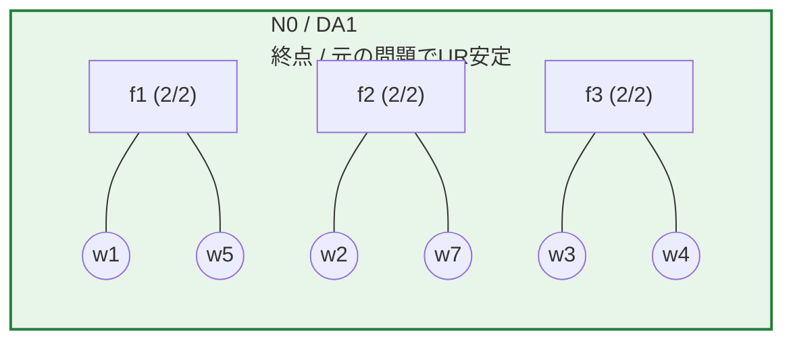

# 個人告白型 Iterated DA（1回の実行）

[比較と再現方法](README.md)

各枠は完全なDAの終了結果。四角が企業、丸が労働者、枠内の線が所属を表す。線のない点線の労働者は未マッチ。太い矢印は実行した削除、点線矢印は未実行の候補。

P番号はその親ノードの違反ペア一覧の順番。異なるペアから同じ削除を選べる場合も枝を分ける。緑は元の問題でUR安定な終点、赤はUR不安定な終点。N番号はDAの訪問順で、図の左右の配置は探索順を表さない。

労働者は削除前の元のラベルで表示する。JSONの添字との対応は入力の `worker_labels_one_based` を参照。

乱数seed: `42`。未実行の枝についてDA結果は計算していない。

## DAごとの状態

### N0 / DA1

累積削除（順番どおり）: なし。

| 企業 | 所属労働者 |
|---|---|
| f1 | {w1, w5} |
| f2 | {w2, w7} |
| f3 | {w3, w4} |
| 未マッチ | ∅ |

違反ペア: なし。

削除後の選好でUR安定: はい。 元の選好でUR安定: はい。

元の問題でのUR逸脱ペア: なし。

## 各終点までの削除と移動

「残した相方」は削除対象に選ばなかった労働者。以降のDAで所属が維持されるとは限らない。移動だけで不安定とは判定せず、削除した組が終点でUR逸脱ペアになるかを元の選好で別途調べる。

### 終点 N0

| 順番 | 選択違反ペア | 削除 | 残した相方 | 削除側：親→直後→終点 | 相方：親→直後→終点 | 削除組が終点のUR逸脱 |
|---|---|---|---|---|---|---|
| — | 削除なし | — | — | — | — | — |
