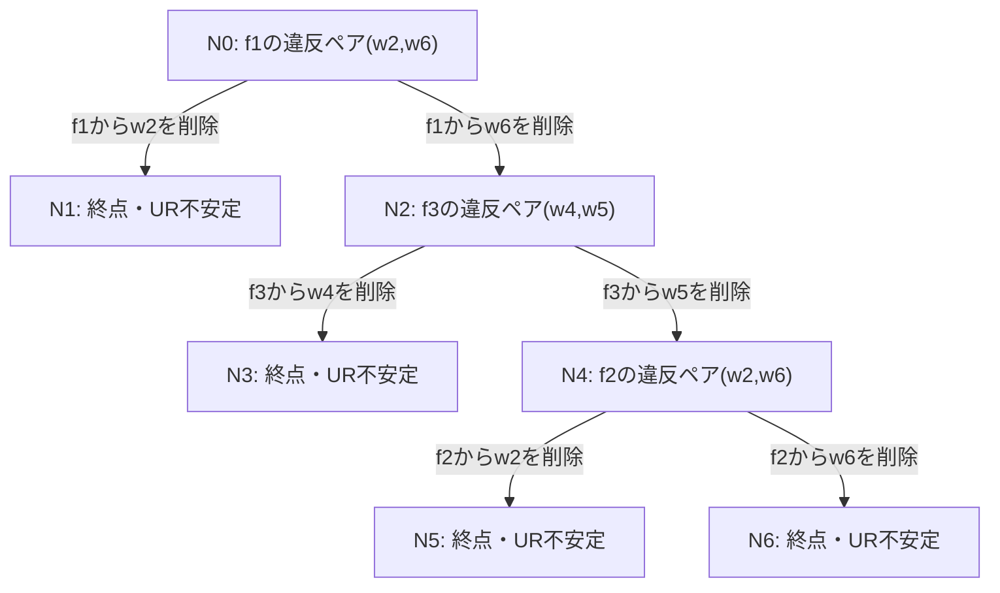

# 5×8問題からf5・w8を除いた4×7実験

実行日: 2026-10-21。

元の入力は [5×8のproblem.json](../5x8/problem.json)。企業f5と労働者w8を取り除き、残る企業・労働者のラベルと相対的な選好順序を維持した。企業定員は `[2,2,2,2]`。選好スコア行列は元の行列の対応する行・列を除いたものをそのまま使い、スコアの振り直しはしていない。

w8を含む同僚禁止ペアも取り除いた。残る禁止ペアは `(w2,w3), (w2,w6), (w3,w5), (w4,w5), (w5,w7)`。

この実験の「元の問題でUR安定」は、再帰的な削除を行う前の **4×7問題** に対する判定を意味する。

## 結果

[個人告白型Recursive DAの分岐図・各状態・移動履歴](recursive_doctor.md) / [4手法の比較](README.md) / [独立検算結果](verification.json) / [4×7の入力](problem.json)

| 手法 | DAノード | 実行した枝 | 終点 | 4×7の元の選好でUR安定な終点 |
|---|---:|---:|---:|---:|
| 個人告白型Recursive DA | 7 | 6 | 4 | 0 |
| 企業告白型Recursive DA | 5 | 4 | 3 | 3 |

個人告白型の削除分岐は次のとおり。



全4手法について、5×8の保存済みJSONの各割当からf5に所属するw8を除くと、今回の木のJSONと完全一致した。元の木では全ノードでf5とw8がマッチしており、今回の除去では残る参加者の割当・違反・削除分岐・UR判定は変わらなかった。

Pythonの独立DAモデルで全ノードを再計算し、割当・違反ペア・削除履歴・移動・UR判定を照合した。Recursive DAの全経路も独立列挙と一致した。

## 再現方法

`MatchingPrograms` を作業ディレクトリとし、新規の出力先を指定する。`--profile 4x7` がf5・w8を除く入力。seedはIterated DAにのみ適用される。

今回使った直接コンパイルによる実行方法（外部テスト依存の取得は不要）:

```sh
c++ -std=c++17 -O2 -I include \
  experiments/universal_replacement/da_search_trees.cpp \
  src/Matching.cpp src/Utils.cpp src/MatchingUtils.cpp \
  src/algorithms.cpp src/algorithmsUtils.cpp \
  -o /tmp/da_search_trees_4x7
/tmp/da_search_trees_4x7 --profile 4x7 --seed 42 --output /tmp/da-trees-4x7
python3 experiments/universal_replacement/render_da_search_trees.py /tmp/da-trees-4x7
```

既存のCMake構成でも `da_search_trees` ターゲットの `--profile 4x7` として実行できる。[共通の実行仕様](../../README.md)を参照。
