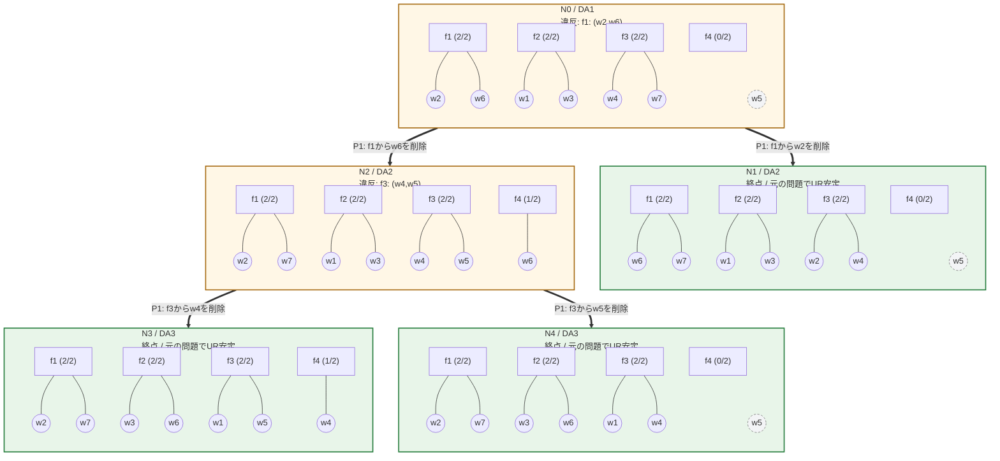

# 企業告白型 Recursive DA（全探索）

[比較と再現方法](README.md)

各枠は完全なDAの終了結果。四角が企業、丸が労働者、枠内の線が所属を表す。線のない点線の労働者は未マッチ。太い矢印は実行した削除、点線矢印は未実行の候補。

P番号はその親ノードの違反ペア一覧の順番。異なるペアから同じ削除を選べる場合も枝を分ける。緑は元の問題でUR安定な終点、赤はUR不安定な終点。N番号はDAの訪問順で、図の左右の配置は探索順を表さない。

## DAごとの状態

### N0 / DA1

累積削除（順番どおり）: なし。

| 企業 | 所属労働者 |
|---|---|
| f1 | {w2, w6} |
| f2 | {w1, w3} |
| f3 | {w4, w7} |
| f4 | ∅ |
| 未マッチ | {w5} |

違反ペア: P1: f1: (w2,w6)。

### N1 / DA2

累積削除（順番どおり）: (f1,w2)。

| 企業 | 所属労働者 |
|---|---|
| f1 | {w6, w7} |
| f2 | {w1, w3} |
| f3 | {w2, w4} |
| f4 | ∅ |
| 未マッチ | {w5} |

違反ペア: なし。

削除後の選好でUR安定: はい。 元の選好でUR安定: はい。

元の問題でのUR逸脱ペア: なし。

### N2 / DA2

累積削除（順番どおり）: (f1,w6)。

| 企業 | 所属労働者 |
|---|---|
| f1 | {w2, w7} |
| f2 | {w1, w3} |
| f3 | {w4, w5} |
| f4 | {w6} |
| 未マッチ | ∅ |

違反ペア: P1: f3: (w4,w5)。

### N3 / DA3

累積削除（順番どおり）: (f1,w6) → (f3,w4)。

| 企業 | 所属労働者 |
|---|---|
| f1 | {w2, w7} |
| f2 | {w3, w6} |
| f3 | {w1, w5} |
| f4 | {w4} |
| 未マッチ | ∅ |

違反ペア: なし。

削除後の選好でUR安定: はい。 元の選好でUR安定: はい。

元の問題でのUR逸脱ペア: なし。

### N4 / DA3

累積削除（順番どおり）: (f1,w6) → (f3,w5)。

| 企業 | 所属労働者 |
|---|---|
| f1 | {w2, w7} |
| f2 | {w3, w6} |
| f3 | {w1, w4} |
| f4 | ∅ |
| 未マッチ | {w5} |

違反ペア: なし。

削除後の選好でUR安定: はい。 元の選好でUR安定: はい。

元の問題でのUR逸脱ペア: なし。

## 各終点までの削除と移動

「残した相方」は削除対象に選ばなかった労働者。以降のDAで所属が維持されるとは限らない。移動だけで不安定とは判定せず、削除した組が終点でUR逸脱ペアになるかを元の選好で別途調べる。

### 終点 N1

| 順番 | 選択違反ペア | 削除 | 残した相方 | 削除側：親→直後→終点 | 相方：親→直後→終点 | 削除組が終点のUR逸脱 |
|---|---|---|---|---|---|---|
| 1 | f1: (w2,w6) | f1からw2 | w6 | f1 → f3 → f3 | f1 → f1 → f1 | いいえ |

### 終点 N3

| 順番 | 選択違反ペア | 削除 | 残した相方 | 削除側：親→直後→終点 | 相方：親→直後→終点 | 削除組が終点のUR逸脱 |
|---|---|---|---|---|---|---|
| 1 | f1: (w2,w6) | f1からw6 | w2 | f1 → f4 → f2 | f1 → f1 → f1 | いいえ |
| 2 | f3: (w4,w5) | f3からw4 | w5 | f3 → f4 → f4 | f3 → f3 → f3 | いいえ |

### 終点 N4

| 順番 | 選択違反ペア | 削除 | 残した相方 | 削除側：親→直後→終点 | 相方：親→直後→終点 | 削除組が終点のUR逸脱 |
|---|---|---|---|---|---|---|
| 1 | f1: (w2,w6) | f1からw6 | w2 | f1 → f4 → f2 | f1 → f1 → f1 | いいえ |
| 2 | f3: (w4,w5) | f3からw5 | w4 | f3 → 未マッチ → 未マッチ | f3 → f3 → f3 | いいえ |
