# 企業告白型 Recursive DA（全探索）

[比較と再現方法](README.md)

各枠は完全なDAの終了結果。四角が企業、丸が労働者、枠内の線が所属を表す。線のない点線の労働者は未マッチ。太い矢印は実行した削除、点線矢印は未実行の候補。

P番号はその親ノードの違反ペア一覧の順番。異なるペアから同じ削除を選べる場合も枝を分ける。緑は元の問題でUR安定な終点、赤はUR不安定な終点。N番号はDAの訪問順で、図の左右の配置は探索順を表さない。

```mermaid
flowchart TB
  classDef unmatched fill:#f3f4f6,stroke:#777,stroke-dasharray:4 3;
  classDef placeholder fill:transparent,stroke:transparent,color:transparent;
  classDef unexecuted fill:#fafafa,stroke:#999,color:#666,stroke-dasharray:4 3;
  subgraph n0["N0 / DA1<br/>違反: f1: (w2,w5)"]
    direction TB
    n0f1["f1 (2/2)"]
    n0f2["f2 (2/2)"]
    n0f3["f3 (1/1)"]
    n0w1(("w1"))
    n0w2(("w2"))
    n0w3(("w3"))
    n0w4(("w4"))
    n0w5(("w5"))
    n0f1 --- n0w2
    n0f1 --- n0w5
    n0f2 --- n0w3
    n0f2 --- n0w4
    n0f3 --- n0w1
  end
  style n0 fill:#fff7e6,stroke:#a66b12,stroke-width:2px
  subgraph n1["N1 / DA2<br/>違反: f2: (w2,w3)"]
    direction TB
    n1f1["f1 (2/2)"]
    n1f2["f2 (2/2)"]
    n1f3["f3 (1/1)"]
    n1w1(("w1"))
    n1w2(("w2"))
    n1w3(("w3"))
    n1w4(("w4"))
    n1w5(("w5"))
    n1f1 --- n1w4
    n1f1 --- n1w5
    n1f2 --- n1w2
    n1f2 --- n1w3
    n1f3 --- n1w1
  end
  style n1 fill:#fff7e6,stroke:#a66b12,stroke-width:2px
  subgraph n2["N2 / DA3<br/>終点 / 元の問題でUR不安定"]
    direction TB
    n2f1["f1 (1/2)"]
    n2f2["f2 (2/2)"]
    n2f3["f3 (1/1)"]
    n2w1(("w1"))
    n2w2(("w2"))
    class n2w2 unmatched
    n2w3(("w3"))
    n2w4(("w4"))
    n2w5(("w5"))
    n2f1 --- n2w4
    n2f2 --- n2w3
    n2f2 --- n2w5
    n2f3 --- n2w1
  end
  style n2 fill:#ffebee,stroke:#b32626,stroke-width:2px
  subgraph n3["N3 / DA3<br/>違反: f2: (w2,w5)"]
    direction TB
    n3f1["f1 (2/2)"]
    n3f2["f2 (2/2)"]
    n3f3["f3 (1/1)"]
    n3w1(("w1"))
    n3w2(("w2"))
    n3w3(("w3"))
    n3w4(("w4"))
    n3w5(("w5"))
    n3f1 --- n3w3
    n3f1 --- n3w4
    n3f2 --- n3w2
    n3f2 --- n3w5
    n3f3 --- n3w1
  end
  style n3 fill:#fff7e6,stroke:#a66b12,stroke-width:2px
  subgraph n4["N4 / DA4<br/>終点 / 元の問題でUR不安定"]
    direction TB
    n4f1["f1 (2/2)"]
    n4f2["f2 (1/2)"]
    n4f3["f3 (1/1)"]
    n4w1(("w1"))
    n4w2(("w2"))
    class n4w2 unmatched
    n4w3(("w3"))
    n4w4(("w4"))
    n4w5(("w5"))
    n4f1 --- n4w3
    n4f1 --- n4w4
    n4f2 --- n4w5
    n4f3 --- n4w1
  end
  style n4 fill:#ffebee,stroke:#b32626,stroke-width:2px
  subgraph n5["N5 / DA4<br/>終点 / 元の問題でUR安定"]
    direction TB
    n5f1["f1 (2/2)"]
    n5f2["f2 (1/2)"]
    n5f3["f3 (1/1)"]
    n5w1(("w1"))
    n5w2(("w2"))
    n5w3(("w3"))
    class n5w3 unmatched
    n5w4(("w4"))
    n5w5(("w5"))
    n5f1 --- n5w4
    n5f1 --- n5w5
    n5f2 --- n5w2
    n5f3 --- n5w1
  end
  style n5 fill:#e8f5e9,stroke:#267d3d,stroke-width:2px
  subgraph n6["N6 / DA2<br/>違反: f2: (w2,w3)"]
    direction TB
    n6f1["f1 (1/2)"]
    n6f2["f2 (2/2)"]
    n6f3["f3 (1/1)"]
    n6w1(("w1"))
    n6w2(("w2"))
    n6w3(("w3"))
    n6w4(("w4"))
    n6w5(("w5"))
    class n6w5 unmatched
    n6f1 --- n6w4
    n6f2 --- n6w2
    n6f2 --- n6w3
    n6f3 --- n6w1
  end
  style n6 fill:#fff7e6,stroke:#a66b12,stroke-width:2px
  subgraph n7["N7 / DA3<br/>終点 / 元の問題でUR安定"]
    direction TB
    n7f1["f1 (2/2)"]
    n7f2["f2 (2/2)"]
    n7f3["f3 (1/1)"]
    n7w1(("w1"))
    n7w2(("w2"))
    n7w3(("w3"))
    n7w4(("w4"))
    n7w5(("w5"))
    n7f1 --- n7w2
    n7f1 --- n7w4
    n7f2 --- n7w3
    n7f2 --- n7w5
    n7f3 --- n7w1
  end
  style n7 fill:#e8f5e9,stroke:#267d3d,stroke-width:2px
  subgraph n8["N8 / DA3<br/>違反: f2: (w2,w5)"]
    direction TB
    n8f1["f1 (2/2)"]
    n8f2["f2 (2/2)"]
    n8f3["f3 (1/1)"]
    n8w1(("w1"))
    n8w2(("w2"))
    n8w3(("w3"))
    n8w4(("w4"))
    n8w5(("w5"))
    n8f1 --- n8w3
    n8f1 --- n8w4
    n8f2 --- n8w2
    n8f2 --- n8w5
    n8f3 --- n8w1
  end
  style n8 fill:#fff7e6,stroke:#a66b12,stroke-width:2px
  subgraph n9["N9 / DA4<br/>終点 / 元の問題でUR不安定"]
    direction TB
    n9f1["f1 (2/2)"]
    n9f2["f2 (1/2)"]
    n9f3["f3 (1/1)"]
    n9w1(("w1"))
    n9w2(("w2"))
    n9w3(("w3"))
    class n9w3 unmatched
    n9w4(("w4"))
    n9w5(("w5"))
    n9f1 --- n9w2
    n9f1 --- n9w4
    n9f2 --- n9w5
    n9f3 --- n9w1
  end
  style n9 fill:#ffebee,stroke:#b32626,stroke-width:2px
  subgraph n10["N10 / DA4<br/>終点 / 元の問題でUR不安定"]
    direction TB
    n10f1["f1 (2/2)"]
    n10f2["f2 (1/2)"]
    n10f3["f3 (1/1)"]
    n10w1(("w1"))
    n10w2(("w2"))
    n10w3(("w3"))
    n10w4(("w4"))
    n10w5(("w5"))
    class n10w5 unmatched
    n10f1 --- n10w3
    n10f1 --- n10w4
    n10f2 --- n10w2
    n10f3 --- n10w1
  end
  style n10 fill:#ffebee,stroke:#b32626,stroke-width:2px
  n0 ==>|"P1: f1からw2を削除"| n1
  n1 ==>|"P1: f2からw2を削除"| n2
  n1 ==>|"P1: f2からw3を削除"| n3
  n3 ==>|"P1: f2からw2を削除"| n4
  n3 ==>|"P1: f2からw5を削除"| n5
  n0 ==>|"P1: f1からw5を削除"| n6
  n6 ==>|"P1: f2からw2を削除"| n7
  n6 ==>|"P1: f2からw3を削除"| n8
  n8 ==>|"P1: f2からw2を削除"| n9
  n8 ==>|"P1: f2からw5を削除"| n10
```

## DAごとの状態

### N0 / DA1

累積削除（順番どおり）: なし。

| 企業     | 所属労働者 |
| -------- | ---------- |
| f1       | {w2, w5}   |
| f2       | {w3, w4}   |
| f3       | {w1}       |
| 未マッチ | ∅         |

違反ペア: P1: f1: (w2,w5)。

### N1 / DA2

累積削除（順番どおり）: (f1,w2)。

| 企業     | 所属労働者 |
| -------- | ---------- |
| f1       | {w4, w5}   |
| f2       | {w2, w3}   |
| f3       | {w1}       |
| 未マッチ | ∅         |

違反ペア: P1: f2: (w2,w3)。

### N2 / DA3

累積削除（順番どおり）: (f1,w2) → (f2,w2)。

| 企業     | 所属労働者 |
| -------- | ---------- |
| f1       | {w4}       |
| f2       | {w3, w5}   |
| f3       | {w1}       |
| 未マッチ | {w2}       |

違反ペア: なし。

削除後の選好でUR安定: はい。 元の選好でUR安定: いいえ。

元の問題でのUR逸脱ペア: (f1,w2)。

### N3 / DA3

累積削除（順番どおり）: (f1,w2) → (f2,w3)。

| 企業     | 所属労働者 |
| -------- | ---------- |
| f1       | {w3, w4}   |
| f2       | {w2, w5}   |
| f3       | {w1}       |
| 未マッチ | ∅         |

違反ペア: P1: f2: (w2,w5)。

### N4 / DA4

累積削除（順番どおり）: (f1,w2) → (f2,w3) → (f2,w2)。

| 企業     | 所属労働者 |
| -------- | ---------- |
| f1       | {w3, w4}   |
| f2       | {w5}       |
| f3       | {w1}       |
| 未マッチ | {w2}       |

違反ペア: なし。

削除後の選好でUR安定: はい。 元の選好でUR安定: いいえ。

元の問題でのUR逸脱ペア: (f2,w3)。

### N5 / DA4

累積削除（順番どおり）: (f1,w2) → (f2,w3) → (f2,w5)。

| 企業     | 所属労働者 |
| -------- | ---------- |
| f1       | {w4, w5}   |
| f2       | {w2}       |
| f3       | {w1}       |
| 未マッチ | {w3}       |

違反ペア: なし。

削除後の選好でUR安定: はい。 元の選好でUR安定: はい。

元の問題でのUR逸脱ペア: なし。

### N6 / DA2

累積削除（順番どおり）: (f1,w5)。

| 企業     | 所属労働者 |
| -------- | ---------- |
| f1       | {w4}       |
| f2       | {w2, w3}   |
| f3       | {w1}       |
| 未マッチ | {w5}       |

違反ペア: P1: f2: (w2,w3)。

### N7 / DA3

累積削除（順番どおり）: (f1,w5) → (f2,w2)。

| 企業     | 所属労働者 |
| -------- | ---------- |
| f1       | {w2, w4}   |
| f2       | {w3, w5}   |
| f3       | {w1}       |
| 未マッチ | ∅         |

違反ペア: なし。

削除後の選好でUR安定: はい。 元の選好でUR安定: はい。

元の問題でのUR逸脱ペア: なし。

### N8 / DA3

累積削除（順番どおり）: (f1,w5) → (f2,w3)。

| 企業     | 所属労働者 |
| -------- | ---------- |
| f1       | {w3, w4}   |
| f2       | {w2, w5}   |
| f3       | {w1}       |
| 未マッチ | ∅         |

違反ペア: P1: f2: (w2,w5)。

### N9 / DA4

累積削除（順番どおり）: (f1,w5) → (f2,w3) → (f2,w2)。

| 企業     | 所属労働者 |
| -------- | ---------- |
| f1       | {w2, w4}   |
| f2       | {w5}       |
| f3       | {w1}       |
| 未マッチ | {w3}       |

違反ペア: なし。

削除後の選好でUR安定: はい。 元の選好でUR安定: いいえ。

元の問題でのUR逸脱ペア: (f2,w3)。

### N10 / DA4

累積削除（順番どおり）: (f1,w5) → (f2,w3) → (f2,w5)。

| 企業     | 所属労働者 |
| -------- | ---------- |
| f1       | {w3, w4}   |
| f2       | {w2}       |
| f3       | {w1}       |
| 未マッチ | {w5}       |

違反ペア: なし。

削除後の選好でUR安定: はい。 元の選好でUR安定: いいえ。

元の問題でのUR逸脱ペア: (f1,w5)。

## 各終点までの削除と移動

「残した相方」は削除対象に選ばなかった労働者。以降のDAで所属が維持されるとは限らない。移動だけで不安定とは判定せず、削除した組が終点でUR逸脱ペアになるかを元の選好で別途調べる。

### 終点 N2

| 順番 | 選択違反ペア | 削除     | 残した相方 | 削除側：親→直後→終点     | 相方：親→直後→終点 | 削除組が終点のUR逸脱 |
| ---- | ------------ | -------- | ---------- | -------------------------- | -------------------- | -------------------- |
| 1    | f1: (w2,w5)  | f1からw2 | w5         | f1 → f2 → 未マッチ       | f1 → f1 → f2       | はい                 |
| 2    | f2: (w2,w3)  | f2からw2 | w3         | f2 → 未マッチ → 未マッチ | f2 → f2 → f2       | いいえ               |

### 終点 N4

| 順番 | 選択違反ペア | 削除     | 残した相方 | 削除側：親→直後→終点     | 相方：親→直後→終点 | 削除組が終点のUR逸脱 |
| ---- | ------------ | -------- | ---------- | -------------------------- | -------------------- | -------------------- |
| 1    | f1: (w2,w5)  | f1からw2 | w5         | f1 → f2 → 未マッチ       | f1 → f1 → f2       | いいえ               |
| 2    | f2: (w2,w3)  | f2からw3 | w2         | f2 → f1 → f1             | f2 → f2 → 未マッチ | はい                 |
| 3    | f2: (w2,w5)  | f2からw2 | w5         | f2 → 未マッチ → 未マッチ | f2 → f2 → f2       | いいえ               |

### 終点 N5

| 順番 | 選択違反ペア | 削除     | 残した相方 | 削除側：親→直後→終点 | 相方：親→直後→終点 | 削除組が終点のUR逸脱 |
| ---- | ------------ | -------- | ---------- | ---------------------- | -------------------- | -------------------- |
| 1    | f1: (w2,w5)  | f1からw2 | w5         | f1 → f2 → f2         | f1 → f1 → f1       | いいえ               |
| 2    | f2: (w2,w3)  | f2からw3 | w2         | f2 → f1 → 未マッチ   | f2 → f2 → f2       | いいえ               |
| 3    | f2: (w2,w5)  | f2からw5 | w2         | f2 → f1 → f1         | f2 → f2 → f2       | いいえ               |

### 終点 N7

| 順番 | 選択違反ペア | 削除     | 残した相方 | 削除側：親→直後→終点 | 相方：親→直後→終点 | 削除組が終点のUR逸脱 |
| ---- | ------------ | -------- | ---------- | ---------------------- | -------------------- | -------------------- |
| 1    | f1: (w2,w5)  | f1からw5 | w2         | f1 → 未マッチ → f2   | f1 → f2 → f1       | いいえ               |
| 2    | f2: (w2,w3)  | f2からw2 | w3         | f2 → f1 → f1         | f2 → f2 → f2       | いいえ               |

### 終点 N9

| 順番 | 選択違反ペア | 削除     | 残した相方 | 削除側：親→直後→終点 | 相方：親→直後→終点 | 削除組が終点のUR逸脱 |
| ---- | ------------ | -------- | ---------- | ---------------------- | -------------------- | -------------------- |
| 1    | f1: (w2,w5)  | f1からw5 | w2         | f1 → 未マッチ → f2   | f1 → f2 → f1       | いいえ               |
| 2    | f2: (w2,w3)  | f2からw3 | w2         | f2 → f1 → 未マッチ   | f2 → f2 → f1       | はい                 |
| 3    | f2: (w2,w5)  | f2からw2 | w5         | f2 → f1 → f1         | f2 → f2 → f2       | いいえ               |

### 終点 N10

| 順番 | 選択違反ペア | 削除     | 残した相方 | 削除側：親→直後→終点     | 相方：親→直後→終点 | 削除組が終点のUR逸脱 |
| ---- | ------------ | -------- | ---------- | -------------------------- | -------------------- | -------------------- |
| 1    | f1: (w2,w5)  | f1からw5 | w2         | f1 → 未マッチ → 未マッチ | f1 → f2 → f2       | はい                 |
| 2    | f2: (w2,w3)  | f2からw3 | w2         | f2 → f1 → f1             | f2 → f2 → f2       | いいえ               |
| 3    | f2: (w2,w5)  | f2からw5 | w2         | f2 → 未マッチ → 未マッチ | f2 → f2 → f2       | いいえ               |
